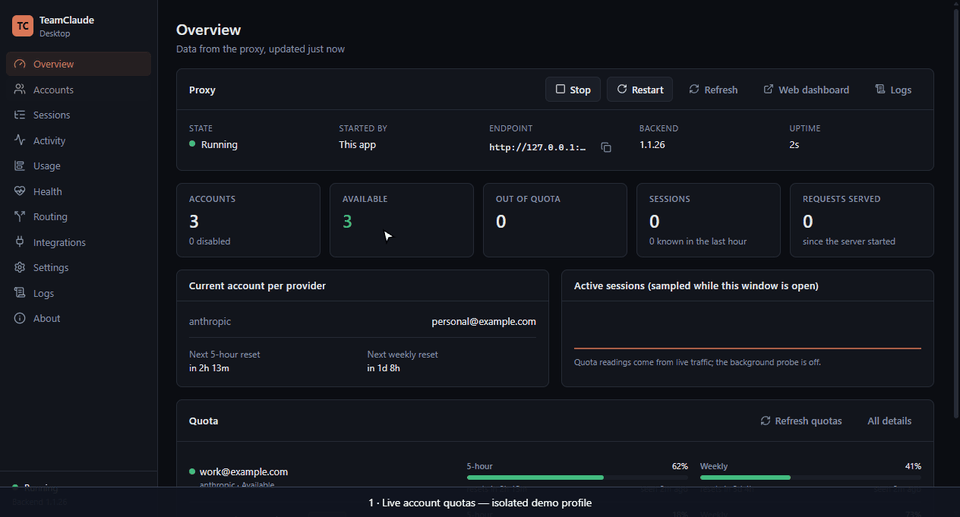

# TeamClaude Desktop

A desktop control panel for the local TeamClaude proxy, for Windows 10/11 x64
and Linux x64. It starts, stops and watches the proxy, shows quota and reset
times for every account, and runs the everyday account and routing commands
without a terminal. The CLI keeps working exactly as before; the desktop app
drives the same proxy and the same config.

How it is built and why: [desktop-architecture.md](desktop-architecture.md).



The recording uses an isolated demo profile with placeholder keys, seeded quota
readings and a local API fixture. No real account or billable request is used.

## Add a third-party API service

In **Accounts → Third-party service**, enter a unique name, the API base URL,
the key and its authentication method (`x-api-key` or `Bearer`). The service
must support **Anthropic Messages API**; an OpenAI-only endpoint needs a
separate protocol adapter. Enter the address before `/v1/messages`, which the
proxy and connection test append automatically.

Enter one model ID per line. If the service uses different IDs, enter
`Claude Code model ID = service model ID`. Choose the destination model under
**Model to test**, then press **Test connection**. This sends a short Messages
request with `max_tokens: 1`; a real service may charge for it. A successful
test checks that model, not every model in the list. Keys and upstream error
bodies are not returned in the test result.

Press **Add service** to save through the backend's config lock and reload the
running proxy. The default priority is 100 (fallback); lower numbers are
preferred. Model mappings rename requests; they do not limit which models an
account can serve in rotation. Keys are not saved in desktop settings or sent
in process arguments. The form also works when the proxy is stopped.

The desktop uses the bundled `add-backend` CLI command for this operation,
including when a newer upstream proxy core is selected. Existing CLI account
commands keep their behavior.

Routing results and distribution names follow the selected interface language.
Original CLI output remains available under **Technical details** for diagnosis.

> Desktop builds are not official TeamClaude releases yet. Build them from
> source, or use artifacts from this repository's CI for testing only.

## Install

| Platform | File | Notes |
| --- | --- | --- |
| Windows | `TeamClaude-Desktop-Setup-<version>.exe` | Per-user install, no administrator rights. The build is unsigned, so SmartScreen asks for confirmation. |
| Windows | `TeamClaude-Desktop-Portable-<version>.exe` | Runs without installing. |
| Linux | `TeamClaude-Desktop-<version>-x86_64.AppImage` | `chmod +x` it and run it. |
| Linux | `TeamClaude-Desktop-<version>-amd64.deb` | `sudo apt install ./TeamClaude-Desktop-*.deb` |

Node.js is not required: the app carries its own copy of the backend and runs
it with Electron's built-in Node runtime.

Uninstalling removes the app only. Your accounts and settings stay in the
TeamClaude config (`~/.config/teamclaude.json`, or `teamrouter.json`, or the
path in `TEAMCLAUDE_CONFIG`), so a reinstall picks them up again.

## First run

1. Open **Accounts** and add an account: **Sign in with Claude** (browser
   OAuth through the TeamClaude CLI), **Sign in with Codex**, **Import from
   Claude Code**, or an **Anthropic API key**. Sign-in runs the existing
   `teamclaude login` flow; tokens never pass through the app window.
2. Press **Start proxy**. The app waits until the proxy actually answers
   before it reports it as running.
3. Open **Integrations** to point Claude Code or Codex at the proxy.

If a proxy is already running — started with `teamclaude server`, by
`systemd --user`, or by another copy of the app — the desktop attaches to it
instead of starting a second one, and marks it as **external**. It will not
stop a proxy it did not start.

## Pages

| Page | What it shows and does |
| --- | --- |
| Overview | Proxy state, endpoint, backend version, account counts, current account per provider, quota bars with 5-hour and weekly reset countdowns, request count, data freshness. |
| Accounts | Accounts grouped by provider: type, token status (never the token), availability and why not, quota, next reset, the last 12 hours of 5-hour (or weekly) use as recorded while the app ran, priority, rotation toggle. Add, import, rename, remove (with confirmation), prefer, sign in again. |
| Sessions | Session counts, and the individual sessions when the proxy runs with `proxy.sessionDetail`, filterable by account and client. |
| Activity | Changes the app observed between status readings (switches, accounts becoming unavailable) and routing lines from the proxy's log, without request content. |
| Usage | Tokens (input, cache read, cache write, output) and requests per account as the proxy counted them since it started, cache hit rate, share of the total, **Export CSV**. No cost is shown: subscription accounts are not billed per token. |
| Health | Proxy state, uptime, how long the local proxy takes to answer its status (now, average, p95, chart), automatic restarts, and per account its state, the reason it rests, errors and switches in the last 24 hours. |
| Routing | **Routing profiles** (save the current threshold and distribution mode under a name, apply in one click here or from the tray), distribution mode (off, even, adaptive, or by load — offered when the running TeamClaude has that mode), the requests each account served in the last ten minutes, switch threshold, priorities, model routes, background probe and warm-up. Settings that can spend extra requests are off by default and carry a warning. |
| Integrations | Detects `claude` and `codex` on PATH, checks the proxy, gives copyable environment lines for bash/zsh, PowerShell and cmd, and can open a terminal with `ANTHROPIC_BASE_URL` set. **Connect an editor** points Claude Code (`~/.claude/settings.json`, read by the CLI and every editor extension) or a VS Code-family editor (VS Code, Insiders, Cursor, Windsurf, VSCodium) or Zed at the proxy in one click; JetBrains IDEs follow Claude Code. **Open a folder…** starts the editor on a folder with the proxy set. See below. |
| Settings | Theme (dark, light, system), language (English, Русский, Українська, Deutsch, Français, Español, Português (Brasil), 简体中文, 日本語), tray and startup behaviour, notifications, the config directory, diagnostics. |
| Logs | The managed proxy's stdout/stderr and the app's own notes, sanitized; filter, search, auto-scroll, clear, the backend crash log, and **Export diagnostics**. |
| About | Desktop, bundled backend and running backend versions, app updates, proxy core updates, links. |

Quota numbers come only from what the backend has seen. When there is no
reading yet the app says **Unknown**, never a guess. A window the plan does
not meter (no 5-hour window, or no shared weekly window on a Team seat) has
no bar, as in `teamclaude status`. A per-minute rate limit
is shown as such and is not counted as an exhausted quota. The quota history
is one reading a minute kept in memory while the app runs; a stretch with no
reading is left out, not filled in.

With the quota probe off (the default) the backend only learns quota from
requests it serves, so an idle account keeps its last reading, and use outside
the proxy never shows. A reading 30 minutes old or more (the server's own
staleness window) whose window has not reset is shown as the floor it is, as
**≥ 40%** on a dimmed bar with its age marked **old reading**. **Refresh
quotas** on Overview and Accounts reads every account from the usage endpoint
once (the TUI's `p`); it spends no quota and runs only when pressed. To keep
idle accounts fresh, turn on the background probe under Routing.

**Run-out forecast.** Under an account's quota bars, and as a banner on
Overview for the account that comes first, the app says when the account
reaches its limit at the current pace, but only when that comes before the
window resets. Weekly windows use the server's own burn-rate forecast (the
level is the switch threshold); the 5-hour window extrapolates the last hour
of recorded readings to 100%. With a notification on (**Quota runs out
within the hour**), it is announced once per window.

Keyboard: **Ctrl+1** … **Ctrl+9** open the first nine pages in sidebar order;
**F5** or **Ctrl+R** reads the proxy status again. A **global shortcut**
(Settings, off by default, `Ctrl+Alt+Shift+N` unless changed) switches the
proxy to the next account that can serve, from any application.

**Quota widget** (Settings or tray, off by default): a small always-on-top
window with each account's 5-hour and weekly use and the soonest run-out.

**Backup and transfer** (Settings): saves the TeamClaude config (accounts with
their credentials, proxy and routing settings) and `teamclaude.state.json`
into one `.tcbackup` file, encrypted with AES-256-GCM under a key derived from
your passphrase with scrypt. Restoring needs the passphrase, refuses a damaged
file, keeps the replaced files next to the config as `.before-restore-<time>`
and restarts a proxy the app started (or asks an external one to reload). The
passphrase is not stored.

## Background mode and tray

- **Minimize to tray** and **Keep proxy running when the window closes** are
  on by default: closing the window hides it, and the proxy keeps serving.
- **Quit** (tray menu) stops the proxy only if this app started it.
- **Launch at login** (off by default) uses the per-user Run key on Windows
  and `~/.config/autostart/teamclaude-desktop.desktop` on Linux. Nothing is
  installed system-wide.
- **Start proxy when the app launches**, **Start minimized** and **Restart
  the proxy after a crash** are off by default. Automatic restart gives up
  after four crashes within five minutes.
- On Linux, if TeamClaude is installed as a `systemd --user` service
  (`teamclaude service install`), the app attaches to that service; stop it
  with `systemctl --user stop teamclaude`.
- If the Linux desktop has no system tray (some Wayland sessions), the app
  still works; closing the window quits it.

## Notifications

Local system notifications for: proxy crashed, account authentication
expired, all eligible accounts unavailable, quota exhausted, backend
recovered, update available, app update ready, proxy core updated, quota runs
out within the hour. Each type can be turned off in Settings. They
are derived from the status the app already polls; no extra request is made
for them, and they never contain a credential.

## Diagnostics

**Export diagnostics** (Settings or Logs) writes a Markdown report with the
OS, versions, proxy state, a numbered account summary (no names or emails)
and the last 200 log lines. Account names in those lines are replaced with
the same numbers and any other email address with `[email]`. Tokens, API
keys, auth headers, cookies, URL passwords and OAuth codes are redacted, and
the config file is never included. Read it before attaching it to an issue.

## Build from source

Requires Node.js 20+ and npm. From the repository root:

```bash
cd desktop && npm ci && npm run dev
```

`npm run dev` builds the app and runs it against the repository's own
backend (`../src`). Checks:

```bash
npm run typecheck && npm run lint && npm test
```

`npm test` runs the unit tests and an integration test that starts the real
backend from `../src` with placeholder accounts and an upstream that never
answers; no credentials are used.

End-to-end tests drive the built app through Playwright's Electron support
with the same placeholder setup: start the proxy, take an account out of
rotation, change the threshold, keep the timeline across a window reload,
export diagnostics with no account names or keys, and stop the owned backend
on quit. They need a display (on Linux CI, Xvfb):

```bash
npm run build && npm run test:e2e
```

Packaging, on the target platform:

```bash
npm run dist:win
```

```bash
npm run dist:linux
```

Artifacts land in `desktop/dist/`. `node scripts/check-dist.mjs win` (or
`linux`) checks that the expected files exist and that nothing in the package
carries a credential or a config file. The Linux `.deb` needs `fakeroot` and
`dpkg`.

## Optional updates

This proposal does not publish desktop releases or configure an update feed.
The packaging config uses `publish: null`; CI packages are unsigned artifacts
for review and testing. App and proxy-core automatic updates are **off by
default**. App updates are unavailable without a packager-configured feed.
Development runs never download an app or core update.

### Proxy core updates

The TeamClaude backend ("core") is updated separately from the app, straight
from upstream's npm releases of `@karpeleslab/teamclaude`. Two minutes after
launch and every 6 hours (**Settings → Updates → Update the proxy core
automatically**, off by default) the app reads the registry's `latest`, and
when it is newer than the core in use:

1. downloads only `https://registry.npmjs.org/@karpeleslab/teamclaude/-/teamclaude-<version>.tgz`
   (at most 20 MB) and checks it against the registry's sha512 `integrity`;
2. unpacks `src/`, `package.json` and `LICENSE` into `<userData>/core/<version>`,
   refusing links and any path that leaves that directory, and checks the
   package name and version;
3. runs `teamclaude --version` from it and expects the version back;
4. makes it the core new proxy starts use, and restarts a proxy the app
   started. If that proxy does not come up, the previous core goes back, the
   version is recorded in `<userData>/core/state.json` and is not installed
   automatically again (About still offers it).

The bundled copy is never modified, so **About → Proxy core → Use the bundled
version** always works, and an app update that ships a newer bundled core
takes over from an older download. With automatic updates off, About offers
Check now and Install. A development run uses the repository checkout and
never downloads a core. A TeamClaude the app did not start is left alone.

### Connecting an editor

**Integrations → Connect an editor** lists Claude Code and the VS Code-family
editors found on this machine with their state (connected, pointing
elsewhere, not connected). Connect writes `ANTHROPIC_BASE_URL` for the proxy:

- Claude Code: `env.ANTHROPIC_BASE_URL` in `~/.claude/settings.json`
  (`$CLAUDE_CONFIG_DIR` when set). The CLI and the editor extensions all read
  it, so while it is connected Claude Code needs the proxy running.
- VS Code, Insiders, Cursor, Windsurf, VSCodium: the
  `claudeCode.environmentVariables` entry in the editor's user
  `settings.json`. The file is JSONC; only that one key is edited in place,
  so comments and layout stay as they were, and other variables in the list
  are kept.

The first change saves `settings.json.teamclaude-backup` next to the file.
Disconnect removes only `ANTHROPIC_BASE_URL`. A file that cannot be parsed
is reported and left untouched. Reload the editor window afterwards.

## Manual test checklist

The automated checks cannot click through a real desktop session. Before a
release, or when a change touches the area, run these by hand on Windows 10/11
x64 and on one Linux x64 desktop (note X11 or Wayland and the desktop
environment). Use your own accounts; never paste their names or tokens into
an issue.

| Area | Steps | Expected |
| --- | --- | --- |
| Clean install | Install the NSIS package (Windows) or the `.deb`/AppImage (Linux) on a machine without Node.js | The app starts; About shows the bundled backend version |
| Existing data | Install on a machine that already has a TeamClaude config and accounts | The accounts appear unchanged; the app does not rewrite the config file |
| Attach | Start `teamclaude` in a terminal, then the app | Phase *running*, ownership *external*; Stop is not offered |
| Own backend | With no proxy running, press Start | Phase *starting* then *running*; Quit from the tray stops it |
| Port conflict | Occupy the configured port with another program, press Start | *Port conflict* is shown; the other program keeps running |
| Sign in | Accounts → add a Claude account, finish the browser sign-in | The job ends successfully and the account appears without a restart |
| API key | Add an API-key account | The key is not shown in the job output or in Logs |
| Account controls | Switch, disable/enable, change priority | The change shows within one poll and in `teamclaude status` |
| Routing | Change the threshold and distribution mode | Values persist after an app restart |
| Tray | Close the window, use the tray menu | The proxy keeps serving; Open and Quit work |
| No tray (Wayland without StatusNotifier) | Close the window | The app quits instead of hiding |
| Launch at login | Turn it on, sign out and in | The app starts (minimized if that is set) |
| Crash | Kill the owned backend process | A crash notification with the exit code; with restart on, it comes back |
| Notifications | Let an account's sign-in expire or exhaust a window | One notification per event, no credential in its text |
| Diagnostics | Export diagnostics | The report numbers accounts and contains no token, key or email |
| Uninstall | Uninstall the app | The TeamClaude config and accounts remain |

Record which rows passed, on what OS and version, in the pull request; rows
not run are listed as not verified.

## Troubleshooting

| Symptom | What to do |
| --- | --- |
| "Port conflict" | Something that is not TeamClaude listens on the configured port. Change `proxy.port` in the config or stop that program; the app will not touch it. |
| "The proxy asks for an API key" | `proxy.apiKey` is set but the app could not read it from the config. Check the config path shown in Settings. |
| Start fails with "no accounts" | The proxy refuses to start with an empty pool. Add an account first. |
| The proxy keeps crashing | See Logs and the crash log there. Automatic restart stops after repeated crashes so the error stays visible. |
| "Backend is older than this app supports" | Update the TeamClaude you run in the terminal, or stop it and let the desktop start its bundled backend. |
