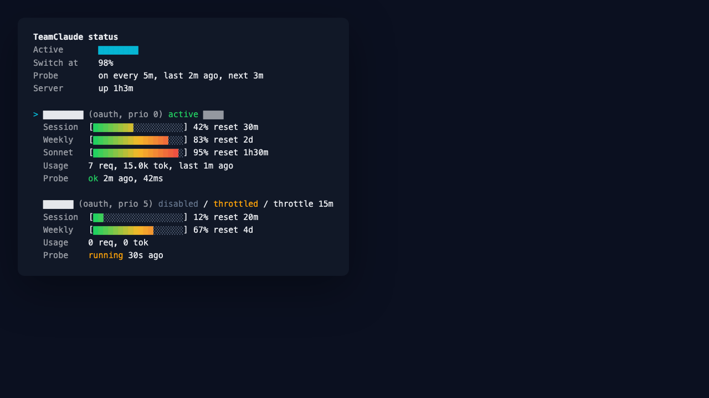

# Usage

Running the server, running Claude Code through it, and the full command reference.

## Start the proxy server

```bash
teamclaude server
```

From a TTY this shows the interactive TUI: an account table with session/weekly quota bars and reset countdowns, a real-time activity log, and keyboard controls.

With accounts from two providers (Claude and Codex) and a terminal at least 127 columns wide, the account table is drawn as two panes side by side, one per provider, each titled with its provider. Each pane carries its own `►` current-account marker, because each provider pool keeps its own cursor. The panes are used only when both can draw every quota bar their rows have, so a fleet with per-model bars, route columns or blocked-family tags needs a little more than 127 columns; a narrower terminal keeps the single list, with the provider named in the type column (and still one `►` per provider). A row whose subscription has reported a weekly window and no 5-hour one (some Codex plans, and a Claude Ultra plan once Anthropic has lifted its 5-hour limit; see [Accounts without a 5-hour window](quota.md#accounts-without-a-5-hour-window)) draws the weekly bar alone, at the width of both cells, while the rows beside it keep `Ses` and `Wk`; a list made only of such rows drops the `Ses` column outright. On a terminal too narrow for two bars per row, where the other rows draw only `Ses`, such a row draws `Wk` in that one slot. An account that has not reported yet keeps both cells, and a row keeps them when its 5-hour window merely runs out.

It falls back to plain log output when stdout is not a TTY (e.g. running as a service). Pass `--headless` (or `--no-tui`) to force plain-log mode from a terminal — useful for backgrounding the proxy.

### Running in a container

A container image is published to GHCR on every version bump (`ghcr.io/karpeleslab/teamclaude`, tagged `latest`, `1`, `1.1` and the full version). It runs `server --headless` bound to `0.0.0.0` inside the container, so publish the port and bind-mount the config file:

```bash
docker run -d --name teamclaude -p 3456:3456 \
  -v ~/.config/teamclaude.json:/data/teamclaude.json \
  ghcr.io/karpeleslab/teamclaude:latest

docker exec -it teamclaude teamclaude login --token   # add accounts from inside
docker exec -it teamclaude teamclaude status
```

A new deployment needs no account to start. With no config to mount, keep `/data` in a volume instead, so the config created on first start survives the container:

```bash
docker run -d --name teamclaude -p 3456:3456 \
  -v teamclaude-data:/data \
  ghcr.io/karpeleslab/teamclaude:latest

docker exec teamclaude node -e "console.log(require('/data/teamclaude.json').proxy.apiKey)"
```

Open `http://<host>:3456/teamclaude/dashboard`, enter the proxy key the second command prints, and use **Sign in to Claude** or **Sign in to Codex** on the **Accounts** page ([Signing in from the dashboard](accounts.md#signing-in-from-the-dashboard)). Until the first account is signed in, the proxy answers the Claude Code and Codex requests it handles with a `503` that says it has no accounts yet (see [Starting with no accounts](accounts.md#starting-with-no-accounts)).

The entrypoint starts as root only long enough to match the runtime user to the owner of the mounted config (or of `/data` when the file does not exist yet), then drops privileges — so a file owned by your user stays writable without a `chown`. `TEAMCLAUDE_UID` (and optional `TEAMCLAUDE_GID`) override the detected owner. stderr is folded into stdout so `docker logs` shows one stream; set `TEAMCLAUDE_SPLIT_STDERR=1` to keep them apart. Auto-update is disabled in the image; pull a new tag to upgrade. The image ships without npm or yarn: the proxy has no runtime dependencies, and leaving the base image's package managers out keeps the image small and free of their known vulnerabilities.

The config is created on first start with a random `proxy.apiKey`. Anything reaching the proxy from outside the container is a non-loopback client and must present that key (see [proxy.host](configuration.md#fields)); only `teamclaude` commands run via `docker exec` are exempt.

To [link](#linked-instances) a proxy in a container to one on another machine, set **Instance address** on its dashboard's **Settings** page to the host's address and published port. The container cannot see the host's address, so without it the link it hands out carries the container's own.

Build it yourself with `docker build -t teamclaude .` from a checkout.

#### Updating a compose deployment in one command

If your proxy runs with `docker compose` from a git checkout (a `docker-compose.yml` with a `build:` section next to the source), `scripts/redeploy.sh` updates it in one step:

```bash
scripts/redeploy.sh            # pull, rebuild, restart, check health
scripts/redeploy.sh --force    # rebuild and restart even if nothing changed
scripts/redeploy.sh --no-pull  # rebuild what is checked out, without pulling
```

It runs from any directory. It finds the checkout it lives in. What it does:

1. `git pull --ff-only`. If the pull fails, it stops, and nothing is rebuilt.
2. If the container already runs the checked-out commit, it stops there. Each build is stamped with its commit, so it can tell.
3. It tags the running image `<name>:previous` (for example `teamclaude:previous`) as the rollback target.
4. It builds the new image. The old container keeps serving during the build, so Claude Code and Codex keep working. If the build fails, the running proxy is not touched.
5. It recreates the container. The proxy is down only for these few seconds.
6. It runs the image's health check until the new container answers. If the container stops or does not answer within 90 seconds (`TEAMCLAUDE_REDEPLOY_TIMEOUT`), the script prints its last log lines, puts the `:previous` image back, and exits with an error.

The proxy stays up during the build, and a failed update rolls back, so an agent that uses the proxy can run the script itself. The service is `teamclaude` by default. Set `TEAMCLAUDE_SERVICE` to use another one, and `COMPOSE_FILE` if your compose file is not in the checkout root. A shell alias makes it one word: `alias tc-update=~/path/to/teamclaude/scripts/redeploy.sh`.

#### Updating a compose deployment on a schedule

To run that script on a schedule, on the host, in the checkout that has your `docker-compose.yml`:

```bash
node src/index.js update compose install            # every day
node src/index.js update compose install --every 12h
node src/index.js update compose status
node src/index.js update compose uninstall
```

`teamclaude update compose install` is the same command when this checkout is the `teamclaude` on your PATH. It installs a per-user timer (systemd on Linux, a LaunchAgent on macOS). It does not start a second proxy. The timer runs `scripts/redeploy.sh`:

1. `git pull --ff-only` of the branch that is checked out. A failed pull stops there, and the running proxy is left as it is.
2. `docker compose build`, while the old container keeps serving. When that container is already running this commit, the script stops before the build and does not restart anything.
3. `docker compose up -d`. The proxy is down only for the container swap. If the new container does not become healthy, the previous image is put back.

Nothing runs until you install the timer. Intervals are `15m` to `30d`; the default is `1d`. `print` writes the unit to the terminal and changes nothing. `"autoUpdate": false` does not remove the timer; `uninstall` does.

The timer does not inherit the shell you installed it from. Settings that choose the Docker daemon or the Compose project are copied into the unit when they are set then: `DOCKER_HOST`, `DOCKER_CONTEXT`, `DOCKER_CONFIG`, `DOCKER_CERT_PATH`, `DOCKER_TLS_VERIFY`, `COMPOSE_PROJECT_NAME`, `COMPOSE_PROFILES`, `COMPOSE_PROJECT_DIRECTORY`, `COMPOSE_PATH_SEPARATOR`, `COMPOSE_ENV_FILES`, and `TEAMCLAUDE_REDEPLOY_TIMEOUT`. A variable the compose file requires, with no default (`${TAILSCALE_IP:?...}` in the preview file), has to be available then too. Export it, or pass `--env TAILSCALE_IP=100.x.x.x`. Repeat `--env` for each one. A value that lives only in the project `.env` (next to the compose file Compose treats as the project directory) is left there; Compose reads that file itself. Anything else in the environment is not copied. `print` shows the copied values before install.

On macOS, installing again or uninstalling while a redeploy is still running refuses the command. Unloading that LaunchAgent would kill the script after the old container may already be gone, so wait for the run to finish and try again. On Linux, disabling the timer leaves a redeploy that has already started running to completion; the command itself still succeeds.

Run it on the host. The container has no copy of the checkout and no Docker socket, and auto-update is disabled in the image, so the command refuses to install from inside the container. Install it on a branch you are willing to have built on its own: the timer fast-forwards whatever is checked out.

On Linux the units are `teamclaude-compose-update.service` and `.timer` under `~/.config/systemd/user/`. Logs: `journalctl --user --unit teamclaude-compose-update.service`. A missed day runs at the next login, which includes installing the timer after today's slot has passed. That run pulls, and it rebuilds only when the container is not already on the checked-out commit. The service has no start timeout, so a long build is not cut off while the previous container is being put back. The timer stops when your last login session ends, unless lingering is on (`loginctl enable-linger $USER`). On macOS the LaunchAgent waits one interval after install before the first run, and logs to `~/Library/Logs/teamclaude-compose-update.log`.

Git has to be able to pull without asking. The timer runs as your user and has no terminal, so a credential helper or an ssh key that does not prompt is what makes the pull succeed. A pull that waits for a password fails, and the running proxy is left as it is.

#### Previewing a branch

`docker/docker-compose.preview.yml` builds a second proxy from a checkout and runs it beside the one you use, for trying a branch's dashboard from another machine on your [Tailscale](https://tailscale.com) network. Every `docker compose` command for it needs `TAILSCALE_IP`, so export it once:

```bash
export TAILSCALE_IP=$(tailscale ip -4)
docker compose -f docker/docker-compose.preview.yml build
docker compose -f docker/docker-compose.preview.yml run --rm preview login
docker compose -f docker/docker-compose.preview.yml up -d
```

`run … login` signs an account in before the proxy starts, with the same paste flow as [over SSH](accounts.md#signing-accounts-in-over-ssh) (`login --codex` for a Codex account). You can skip it and sign in from the dashboard instead. Then open `http://<tailscale-ip>:3466/teamclaude/dashboard` and enter the preview's own proxy key:

```bash
docker exec teamclaude-preview node -e "console.log(require('/data/teamclaude.json').proxy.apiKey)"
```

It cannot disturb the proxy already running:

- It keeps its config and state in its own volume (`teamclaude-preview_preview-data`), never `~/.config/teamclaude.json`.
- It listens on host port 3466 instead of 3456.
- It is published on the Tailscale address only, so nothing on the LAN or the internet reaches it.
- Nothing is pointed at it: Claude Code and Codex keep talking to the proxy they were set up with.

A sign-in in the preview is a login of its own, separate from the running proxy's. Stop it with `docker compose -f docker/docker-compose.preview.yml down`; add `-v` to drop its volume and the accounts in it.

### Session titles in the activity log

Claude Code sends `x-claude-code-session-id` with each request, so every activity row belongs to a known
session. With `sessionTitles.enabled` set, the row is labelled with that session's name:

```
 ⠋ 17:42:57  adv-review-rewrite POST /v1/messages (claude-opus-5) → claude@rikbrown.co.uk (1.9s...)
 ⠋ 17:42:57  emmy-merge         POST /v1/messages (claude-opus-5) → claude@rikbrown.co.uk (0.4s...)
 ⠋ 17:42:57                     POST /v1/messages?beta=true (claude-opus-5) → claude@rikbrown.co.uk (1.1s...)
```

The name comes from Claude Code's own files under `~/.claude/projects`, in this order:

1. `<session-id>/custom-title.json`, written by `/rename`.
2. A `custom-title` record in the session transcript, which is the only copy for a session renamed before
   that file existed.
3. An `ai-title` record, the title Claude Code generates. Most sessions have one without a rename.

A session with none of these keeps the first six hex characters of its id. So does a request that carries no
session header: a bare SDK or API client reaches the proxy anonymously, and no file names it.

Each label is read once and re-read at most every 30 seconds, off the render path, so a `/rename` reaches the
log without a restart and no frame waits on the disk. Only a session id shaped like a UUID is looked up, and a
title is printed with its control characters removed, since both arrive from outside the proxy.

This is off by default: it reads the tail of every visible session's transcript, which is further than the
proxy reaches for anything else unless asked. Press **g** → **Session titles** to turn the labels on and off
while the proxy runs. Set `sessionTitles.width` to change the columns the label gets. See
[configuration](configuration.md).

Headless, you can re-sync accounts from the config without a restart by POSTing to the local control endpoint (the equivalent of pressing **R** in the TUI):

```bash
curl -X POST http://localhost:3456/teamclaude/reload
```

The switch threshold has a control endpoint of its own — the same change as `teamclaude threshold 90`, and what the browser dashboard's **Switch at** control sends:

```bash
curl -X POST http://localhost:3456/teamclaude/threshold \
  -H 'content-type: application/json' -d '{"percent": 90}'
```

It is a setting, not a nudge: the number is written to the config file (under its lock, so an edit the CLI or TUI made meanwhile survives) and the server reloads to apply it. The answer carries the stored ratio and, when one number replaced a per-bucket table, `dropped` names the buckets that went. Per-account `accounts[].switchThreshold` overrides are untouched. A request authenticated with a `proxy.clientKeys` entry is refused with 403 — a client key is a tenant of the proxy, not its operator; the shared `proxy.apiKey` and key-exempt loopback callers are allowed.

You usually don't need to call it directly. `login`, `import`, `enable`, `disable`, `cordon`, `uncordon`, `priority`, `ends`, `route`, `threshold`, `distribute`, `probe` and `warmup` notify a running server themselves.

Control-plane **writes** (`reload`, `switch`, `session-pin`, `threshold`, `priority`, `disable`, `account-cordon`, `account-release`, `drain`, `undrain`, `remove`, `client-keys/create`, `client-keys/revoke`, `client-keys/show`, `dashboard-login` and the `login/*` sign-in steps) are refused when the request carries a browser `Origin` or a cross-site `Sec-Fetch-Site`. The exception is a request that presents a configured proxy key and whose `Origin` names the very host it was sent to: that is the dashboard opened at a plain-`http` address of another machine (a Tailscale or LAN IP), where browsers send `Origin` but no `Sec-Fetch-Site`. A page on another site cannot send the key, which the browser does not attach by itself. Loopback is exempt from the proxy API key so the CLI needs no configuration, but that exemption also covers any web page you happen to visit: a page can POST to `127.0.0.1` cross-origin without a preflight, and while it cannot read the reply, the write would still land. `curl` and the CLI send neither header and are unaffected. Reads (`status`) are not restricted — the same-origin policy already stops a page from seeing the response.

`GET /teamclaude/quota` is the compact read endpoint for status-line integrations. It returns tier-weighted fleet aggregates and the underlying per-account limits; see [Fleet quota endpoint](quota.md#fleet-quota-endpoint).

Switching the account by hand has the same headless path — the equivalent of pressing **s** in the TUI and confirming with the default target selected:

```bash
teamclaude switch                 # list accounts, marking the current one
teamclaude switch me@example.com  # make that account the preferred one
teamclaude switch me@example.com --session   # move only the session this runs in
```

`--session [<id>]` moves one session instead of the fleet; see [Move one running session](routing.md#move-one-running-session).

Both forms need a running server: the choice is runtime state and is never written to the config, so there is nothing to apply on a later restart. The command wraps `POST /teamclaude/switch` with a `{"account": "<name>"}` body, and the account can be given as its display name, its bare email, its `accountUuid`, its `orgUuid`, or the fully qualified `accountUuid/orgUuid` — the last being the only form that tells apart one email that holds accounts in several orgs. The rotation index is deliberately not accepted — it is array position, so a script pinned to `1` would silently follow a different account after a removal.

As in the TUI, a manual choice takes precedence over the automatic rankings (`priority`, and `preferSoonestWeeklyReset` where it is on) while the account remains available. Model-route allowlists, quota thresholds and account caps still apply; switching does not authorize paid extra usage. Once rotation moves off the account (it filled up, was throttled or disabled), the preference is gone and the rankings apply again; a model-scoped diversion or another provider's traffic does not release it. With `distributeSessions` on, new conversations are placed within the best priority tier and do not read the manual choice, so a switch to an account that a higher-priority account outranks is reported as not taking effect. Among accounts of the top priority, `eligible: true` then means a new conversation can be placed there, not that it will be. The choice is runtime state and is not persisted. A switch onto an account that cannot take traffic at all is still recorded, exactly as in the TUI, but the command says so instead of reporting a clean success:

```text
Switched to "me@example.com"
Warning: "me@example.com" is disabled, so requests will not route to it until that changes.
```

Taking an account out of rotation, or moving it in the priority order, has a headless path too — the web equivalent of `teamclaude disable` / `enable` and `teamclaude priority --first` / `--last`, and what the browser dashboard's buttons call:

```bash
curl -X POST http://localhost:3456/teamclaude/disable \
  -H 'content-type: application/json' -d '{"account": "me@example.com", "disabled": true}'
curl -X POST http://localhost:3456/teamclaude/priority \
  -H 'content-type: application/json' -d '{"account": "me@example.com", "place": "first"}'
curl -X POST http://localhost:3456/teamclaude/account-cordon \
  -H 'content-type: application/json' -d '{"account": "me@example.com", "cordoned": true}'
```

`POST /teamclaude/priority` takes `{"account", "place": "first" | "last"}` or `{"account", "priority": <integer>}`; `POST /teamclaude/disable` takes `{"account", "disabled": true | false}`. Both accept an optional `"org"` (name or uuid) for an email that holds accounts in several orgs — an ambiguous name is refused rather than guessed. Unlike `switch`, these are config **writes**: the change is saved to the config file under the same lock the TUI uses, and the server reloads itself afterwards, so it survives a restart. `place` is relative — `first` lands one below the lowest priority in the fleet, `last` one above the highest — and the reply carries the account as it now stands (`{"ok": true, "name": ..., "priority": ...}` or `{"ok": true, "name": ..., "disabled": ...}`), so a caller learns the number it did not choose. `POST /teamclaude/account-cordon` takes `{"account", "cordoned": true | false}` (see [Cordoning one account](#cordoning-one-account)) and answers the same way, plus `remaining`, the conversations still on the account, and `inService`, how many other accounts of its provider are neither disabled nor cordoned. An unknown or ambiguous account, or a priority that is not an integer, is a `400` with the reason; a write that landed but whose reload failed is a `500` that says so, since the file did change. A request authenticated with a `proxy.clientKeys` entry is refused with `403`: a client key is for using the fleet, not for changing which accounts it contains. Use the shared proxy key, or call from the proxy's own machine.

### Account sign-in and removal endpoints

Removing an account and signing one in have endpoints too, which the dashboard's buttons call:

```bash
curl -X POST http://localhost:3456/teamclaude/remove \
  -H 'content-type: application/json' -d '{"account": "me@example.com", "provider": "codex"}'
```

`POST /teamclaude/remove` takes `{"account"}` (any identifier `switch` takes) with an optional `"provider"` (`anthropic`, `codex`, …) and `"org"`, for one email that holds a Claude and a Codex login or seats in several orgs. An ambiguous name is a `400` and an unknown one a `404`. The account leaves the running fleet and the config file at once, credentials included, and the reply is `{"ok": true, "name", "provider", "persisted"}`. A removal waits for a reload in progress. A `500` means the account may already be out of the running server but the config file could not be saved.

A sign-in is four calls, all POSTs with a JSON body. `login/start` `{"provider": "claude" | "codex"}` answers `{"id", "provider", "url", "browserUrl", "listening", "note"}`: `url` is the link to open (it works from any device), and `browserUrl`, Claude only, is the link whose redirect reaches this machine's loopback listener. `login/code` `{"id", "code"}` takes what the browser was left with: Claude's code, or the whole `http://localhost:1455/auth/callback?…` address for Codex. A paste that cannot be used is a `400` with the reason, and the sign-in keeps waiting. `login/status` `{"id"}` answers `state`: `waiting`, `finishing` (the code has arrived, by paste or the listener, and is being exchanged), `succeeded` (with `account`, `action`, `added` or `updated`, and `fileBacked`, true when the account reads its tokens from an `importFrom` file and so does not use the ones just stored), `failed` (with a one-line `error`), `cancelled`, or `unknown` for a sign-in that was replaced or that a restart forgot. `login/cancel` `{"id"}` gives up and closes the listener. The server runs one sign-in at a time, and starting one cancels the one before, unless that one is `finishing`: then `login/start` is a `400` until it ends. `login/cancel` answers `cancelled: false` once the code has arrived. A sign-in waits five minutes. All five routes are refused for a `proxy.clientKeys` key with `403`.

### Client key endpoints

The Clients page's **Client keys** card calls three endpoints, which add, revoke and read back `proxy.clientKeys` entries:

```bash
curl -X POST http://localhost:3456/teamclaude/client-keys/create \
  -H 'content-type: application/json' -d '{"name": "laptop"}'
```

`POST /teamclaude/client-keys/create` takes `{"name"}`: up to 64 letters, digits, spaces and `. _ @ -`, starting with a letter or digit. It generates a key, writes `{ "name", "key" }` to `proxy.clientKeys` under the config lock, reloads, and answers `{"ok": true, "name", "key", "firstKey", "grokLocal"}`. `grokLocal` is the address a Grok Build on the proxy's machine uses with no key (`http://127.0.0.1:<port>/grok/v1`), or `null` when the proxy has none. `/teamclaude/status` lists the configured names under `clientKeys` and never the keys; only this reply and `show` return one. `firstKey` is `true` when the proxy had no key at all before, so callers on other machines, which the open gate admitted until then, now need one. A name already in use is a `400`, since two keys under one name would share one usage counter. `POST /teamclaude/client-keys/revoke` takes `{"name"}`, removes every entry under that name, reloads, and answers `{"ok": true, "name", "removed"}`. A client using the key is refused from then on. The usage already booked under the name stays. An unknown name is a `400`, and so is the proxy's last key when there is no `proxy.apiKey`: with no key left the gate would admit everybody, so set `proxy.apiKey` first. A reload failure on either is a `500` that says the file was saved. `POST /teamclaude/client-keys/show` takes `{"name"}` and answers `{"ok": true, "name", "key", "grokLocal"}` with the key stored under that name (the first, if a hand edit gave the name two), uncached, writing nothing. An unknown name is a `400`. All three are refused with `403` for a `proxy.clientKeys` key, so only the shared proxy key or a key-exempt loopback caller can manage or read keys.

### Client connect endpoint

The Clients page's **Connect your tools** card reads and changes the same settings as [`teamclaude connect`](#connecting-your-tools-in-one-step), on the machine the proxy runs on:

```bash
curl http://localhost:3456/teamclaude/clients/connect
curl -X POST http://localhost:3456/teamclaude/clients/connect \
  -H 'content-type: application/json' -d '{"clients": ["claude", "codex", "grok"], "action": "connect"}'
```

`GET /teamclaude/clients/connect` answers `{"ok": true, "clients": [...]}`, one entry per client:

```json
{ "id": "codex", "label": "Codex CLI", "where": "/home/me/.codex/config.toml",
  "state": "elsewhere", "current": "model_provider \"openai\"" }
```

`state` is `connected`, `disconnected`, `elsewhere` (with `current`, the setting it has now) or `unreadable` (with `problem`, for example a `settings.json` that is not valid JSON). `where` is the file, or `Windows user environment` for Grok Build on Windows. The Grok Build entry also has a `note`: it reads the variable when it starts, from a terminal opened afterwards.

`POST /teamclaude/clients/connect` takes `{"clients": [...], "action": "connect" | "disconnect", "replace": true}`, with `clients` a non-empty list of `claude`, `codex`, `grok` (or `all`) and `replace` optional. Each client is handled as `teamclaude connect` handles it: a setting that names another address is kept unless `replace` is `true`, and `disconnect` takes out only what is ours. It answers `200` with `{"ok", "clients", "errors"}`: the states after the change, and one `{"id", "error"}` per client that was left as it was, with `"replaceable": true` when the same request with `replace` would go ahead. `ok` is `false` when `errors` is not empty. A body that names no action or an unknown client is a `400`.

Both are refused with `403` for any caller that is not on the proxy's own machine, even with a valid proxy key: they edit the files of the user the proxy runs as. That means a direct loopback connection, with no forwarding header and a `Host` that names this proxy, and `proxy.trustLoopback` not `false`. A Docker port mapping or a reverse proxy does not count, so the card is hidden there. A `proxy.clientKeys` key is refused too, and a web page on another origin is refused like every other control `POST`.

### TUI keyboard shortcuts

| Key | Action |
| --- | --- |
| `s` | Switch active account (`←`/`→` picks the default account or a specific [route](routing.md#model-routes)) |
| `d` | Enable/disable an account |
| `l` | Sign an account in again (opens on the first account in `error`; not in attach mode). A panel shows the sign-in link, clickable and copied to the clipboard, and takes the pasted answer back, so it works over SSH — see [Signing in again from the TUI](accounts.md#signing-in-again-from-the-tui) |
| `r` | Choose an OAuth Claude or Codex account, then read and spend a [banked reset](accounts.md#reading-and-spending-a-reset-by-hand). Starts on the first account holding one; local TUI only |
| `p` | Refresh quota on all accounts (one-shot probe of the zero-spend usage endpoint) |
| `R` | Reload accounts from config |
| `g` | Settings (threshold, quota probe, quota-bar contents, routing, add/remove/reorder/sort accounts, upstream and account proxies, sx.org) |
| `q` | Quit |

In selection mode, use `j`/`k` or the arrow keys to navigate, `Enter` to confirm, `Esc` to cancel.

In the Resets panel, only held grants are listed; spent grants are hidden. Each row shows the kind in bold, the number left, the limits it clears and its expiry. A held but blocked grant is dimmed, with its reason on the same line. The selected grant alone shows its upstream label below the row, dimmed, and its warnings in yellow. Dates and times are local; expiry is a date more than a day away (with the year only if it differs from this year), or a countdown within a day. An empty list says `no banked resets`. `↑`/`↓` or `j`/`k` choose a held grant, `Enter` shows the spend confirmation and warnings, and `y`/`Y` spends it. Any other key cancels the confirmation. Blocked grants cannot be spent; warnings do not block a manual spend. Opening uses a cached reading up to five minutes old without a request, and the header shows its age (`as of 1m ago`). Claude's quota probe fills this cache from its existing usage request; Codex caches its detail rows. Within the panel, `r` reads again after two minutes, or shows `read 40s ago — wait 80s` without a request. A 429 starts the two-minute wait again; upstream `Retry-After` can extend it. Failed reads keep earlier grants visible with `stale`, their original age and the error, plus `retry in 90s` when upstream gives a retry delay. Without a cached reading, only the error is shown. Grant ids and detail rows stay in memory, never config or saved quota. `Esc`/`q` closes the panel. Spending cannot be undone or cancelled once it starts.

The settings screen is a list, not a set of letter shortcuts: `↑`/`↓` move between rows, `←`/`→` change the value in place (threshold by 1%, probe by 30s, modes cycle), `Enter` opens a row that needs typing or a sub-screen, `Esc` goes back.

**Reorder accounts** opens the account list with the same two pairs of keys and one extra job for them: `↑`/`↓` pick the account, `←`/`→` move *that account* up and down the list, `Enter` or `Esc` goes back. Every move applies as you make it and is written a moment after the keys stop (or on leaving the screen), so there is nothing to confirm and nothing to cancel. An account moves among the accounts of its own provider: a mixed Claude and Codex fleet is drawn grouped by provider, so a move that would cross into the other group does nothing. This is the order the list is **drawn** in and nothing else — rotation order is [`priority`](routing.md#choosing-an-account), which the screen never touches. `teamclaude attach` draws the same order: each account in `/teamclaude/status` carries its `displayOrder` (`null` until it has been placed).

**Sort accounts** chooses what orders the list inside each provider group: **arranged** (your order, above), or the soonest reset of one window — **session reset** (five-hour), **weekly reset**, **S7 reset** or **F7 reset** — which puts the account whose window ends soonest at the top: the quota you lose first if nothing spends it. S7 and F7 read the all-models weekly on an account that has no Sonnet or Fable bucket of its own, since that is the window its Sonnet or Fable use counts against. Accounts with no reading for the window go last (for the session sort, that includes every account with no five-hour window open), and your arrangement breaks ties. A third-party backend sorts by its probed windows, with the monthly one standing in for a weekly reset the plan does not have. The reorder screen always shows the arranged order, because that is the order it edits. `teamclaude attach` reads the same `accountSort` from its own config file.

## Run Claude Code through the proxy

```bash
teamclaude run
```

`run` probes the proxy first. If it's up, Claude Code is routed through it; if it's **not** running, `run` errors out rather than silently bypassing the proxy — which would spend your own quota with no rotation. Pass `--auto-fallback` to launch `claude` directly instead when the proxy is down:

```bash
teamclaude run --auto-fallback
```

Since **1.1.0**, `run` defaults to [MITM forward-proxy mode](proxy-modes.md#mitm-proxy-mode-default) so even hardcoded `api.anthropic.com` endpoints are intercepted. For the previous base-URL-only behavior, pass `--no-mitm` — or set `defaultClientMode: "base-url"` in the config (the **Client mode** row on the TUI settings screen) to make that the default for `run` and `env` alike, with `--mitm` opting back in per launch:

```bash
teamclaude run --no-mitm
```

Arguments after `--` go to `claude`:

```bash
teamclaude run -- --model opus
```

**Claude Code still needs a login of its own.** In both modes the client checks its local login (`~/.claude/.credentials.json`, or the Keychain on macOS) before it sends anything, and the proxy only sees a request once that check passes. The pool's accounts do not stand in for it: they are what the proxy uses upstream, and the two expire independently. The exception is a pool account holding this same login, imported with `teamclaude import` or read through `importFrom`: the two then share it, and whichever renews first ends the other's copy (see [Import from Claude Code](accounts.md#import-from-claude-code)). So a `claude` that exits at once with `Failed to authenticate: OAuth session expired and could not be refreshed` is reporting its own login, not the pool — run `claude auth login` and launch again. `run` prints a hint to that effect when `claude` dies within seconds of launch and the local login is missing or past its expiry.

### Setting the environment yourself

`teamclaude env` prints the same export lines `run` uses:

```bash
eval "$(teamclaude env)"           # MITM: HTTPS_PROXY + NODE_EXTRA_CA_CERTS
eval "$(teamclaude env --no-mitm)" # base-URL: ANTHROPIC_BASE_URL only
eval "$(teamclaude env --mitm)"    # MITM regardless of defaultClientMode
claude
```

Only the export lines go to stdout (so `eval` is safe); a short summary and any hints go to stderr. No `ANTHROPIC_API_KEY` is emitted — loopback clients are exempt from the proxy key gate, and setting it would drop Claude Code out of subscription mode. A remote (non-loopback) client must add the proxy key itself.

**The proxy variables are shell-wide.** In MITM mode the eval exports `HTTPS_PROXY` and friends, and every other tool in that shell — `gh`, `git`, a package manager — follows them to a listener that only speaks to the providers' hosts; in a sandboxed shell that can surface as a synthetic 403 from an unrelated command. If that is your shell, set `defaultClientMode: "base-url"` (the **Client mode** row on the TUI settings screen): `env` then emits `ANTHROPIC_BASE_URL` only and, re-evaluated, unsets the proxy variables an earlier MITM eval left pointing at this proxy, leaving a real corporate proxy alone. `teamclaude run` scopes the variables to the `claude` process either way.

**Your own `NO_PROXY` is kept.** `run` and `env` both set `NO_PROXY=localhost,127.0.0.1,::1` and append whatever the launching shell already had. That matters for local development: a dev server on a name like `app.test` resolves to 127.0.0.1 through a local resolver, and a forward to loopback is refused, so a client that proxied it would get a 403 on every retry. `export NO_PROXY=.test` before the eval (or before `run`) and the launched client gets `localhost,127.0.0.1,::1,.test`. The one entry that is dropped is `*` — it would send `api.anthropic.com` around the proxy as well, silently ending rotation; use `--no-mitm` for a direct launch.

**Using an agent multiplexer or a tool that spawns `claude` itself?** Export this environment in the process that launches those `claude` instances — e.g. `eval "$(teamclaude env)"` in the shell you start the multiplexer from. Every spawned `claude` then gets the same routing (and MITM interception of hardcoded endpoints) without going through `teamclaude run`. The trade-off: `run`'s proxy-up/down guard only applies when you launch via `run`, so start the server before the multiplexer.

### Routing plain `claude` automatically

So you don't have to type `teamclaude run` every time, add a shell alias that sends plain `claude` through the proxy:

```bash
teamclaude alias              # print the alias for your shell
teamclaude alias --install    # or write it to your shell rc (--uninstall to remove)
```

This is an interactive-shell alias — it affects `claude` typed at a prompt, not `claude` spawned by editors or scripts. It's a thin passthrough to `teamclaude run`, which holds the proxy-up/down logic (so it errors when the proxy is down; add `--auto-fallback` to launch claude directly instead).

The Claude Code extension for VS Code starts `claude` itself in its chat panel, so neither the alias nor `run` reaches it there. It takes the proxy settings from its own setting instead: see [VS Code extension](vscode.md). In terminal mode (`claudeCode.useTerminal`) on macOS and Linux, and on Windows in a Git Bash or WSL terminal, it types `claude` into an integrated terminal, where the alias does apply.

### Connecting your tools in one step

`teamclaude connect` points Claude Code, the Codex CLI and Grok Build on this machine at the proxy by writing their own settings, so you don't edit any of them by hand:

```bash
teamclaude connect                  # all three
teamclaude connect codex grok       # or only some: claude, codex, grok
teamclaude connect --status         # where each one points now; changes nothing
teamclaude disconnect               # take out what connect wrote (also per client)
```

| Client | Where | What connect writes |
| --- | --- | --- |
| Claude Code | `~/.claude/settings.json` (`$CLAUDE_CONFIG_DIR` when set) | `env.ANTHROPIC_BASE_URL = "http://127.0.0.1:<port>"`. Every other key is kept. No `ANTHROPIC_API_KEY`: a loopback client needs no key, and a key would take Claude Code out of subscription mode. |
| Codex CLI | `~/.codex/config.toml` (`$CODEX_HOME` when set) | `model_provider = "teamclaude"` and the `[model_providers.teamclaude]` table from [Codex accounts](accounts.md#codex-accounts-experimental). A table you added by hand is replaced, never duplicated. When the root `profile` key selects a profile that sets its own `model_provider`, that line is the one changed, since it overrides the root one. A profile chosen with `codex --profile` on the command line is not seen. |
| Grok Build | On Windows, your user environment. Elsewhere, your shell's rc file (`~/.bashrc`, `~/.zshrc`, `~/.profile`, or fish's `conf.d/teamclaude.fish`) | `GROK_CLI_CHAT_PROXY_BASE_URL = "http://127.0.0.1:<port>/grok/v1"`. Grok Build reads it when it starts, so open a new terminal after connecting. |

The **Connect your tools** card on the dashboard's [Clients page](#sessions-and-clients) does the same with a button per tool. Each client prints one line: `connected`, `not connected`, `uses <setting>` when it points somewhere else, or `unreadable` with the reason (a `settings.json` that is not valid JSON is never overwritten).

- **A setting that points elsewhere is kept.** If Claude Code already has another `ANTHROPIC_BASE_URL`, or Codex another `model_provider`, `connect` says so, changes nothing for that client, and exits non-zero. `--replace` overwrites it. For Codex the previous provider is kept in a comment on the new line (`model_provider = "teamclaude" # teamclaude: was "openai"`), and `disconnect` puts it back.
- **`disconnect` removes only what is ours.** A setting that names another address stays as it is. Running either command twice has the same effect as once.
- **The address is the proxy's loopback address**, from `proxy.port` and the bind. A proxy with none (`proxy.trustLoopback` is `false`, or `proxy.host` is one address other than loopback) is refused: a client on this machine could only reach it with a key, and these settings carry none.
- **Claude Code then reaches the proxy by base URL, from every terminal and the background agents alike.** It skips the check `teamclaude run` makes that the proxy is up, and Claude Code treats a base URL that is not Anthropic's as a gateway (tool search and Remote Control off; see [Why MITM mode, not a base URL](vscode.md#why-mitm-mode-not-a-base-url)). If you rely on those, use `teamclaude run` or the alias instead and `teamclaude disconnect claude`.

## Command reference

```bash
teamclaude login             # Add an account via OAuth (--api for an API key)
teamclaude import            # Import credentials from Claude Code
teamclaude server            # Start the proxy (--headless for plain logs)
teamclaude run               # Run Claude Code through the proxy
teamclaude env               # Print export lines for routing claude yourself
teamclaude alias             # Print/install a `claude` alias that routes via the proxy
teamclaude connect           # Point Claude Code, Codex and Grok Build at the proxy (--status, --replace)
teamclaude disconnect        # Take those settings out again
teamclaude accounts          # List accounts with subscription tier and token status
teamclaude status            # Show live proxy status (requires running server)
teamclaude attach            # Open the live dashboard against a running server
teamclaude dashboard         # Open the web dashboard in the browser (needs server)
teamclaude desktop           # Start the proxy in the background if needed, then open the dashboard
teamclaude service install   # Run the proxy as a login service (uninstall/status/print)
teamclaude switch [name]     # Prefer an account; no name lists them (needs server)
teamclaude remove <name>     # Remove an account (by name or email)
teamclaude disable <name>    # Temporarily exclude an account from rotation
teamclaude enable <name>     # Re-enable it (also clears a stuck error state)
teamclaude cordon <name>      # Send it no new conversations; the ones on it stay
teamclaude uncordon <name>    # Send it new conversations again
teamclaude release <name>     # Unpin the conversations on it; each is placed again on its next request
teamclaude priority <name> 1 # Set rotation priority (lower = preferred)
teamclaude ends <name> 2026-12-01 # The account stops being usable then: spend it first (--clear to unset)
teamclaude rename <name> <new> # Rename an account (and the routes that list it)
teamclaude route list        # Manage per-model routes (add/rm)
teamclaude threshold 90      # Utilization at which rotation leaves an account
teamclaude distribute on     # Spread new sessions across equal-priority accounts
teamclaude distribute affinity  # Spend a 5-hour window about to reset first; conversations stay put until their account is out of usage
teamclaude probe 300         # Enable background quota refresh (off by default)
teamclaude warmup 600        # Enable keep-warm (off by default, spends quota)
teamclaude warmup reset 15:30 --timezone Europe/Moscow
                             # Schedule warm-up for a daily target reset
teamclaude warmup rolling 15:30 --timezone Europe/Moscow
                             # Anchor resets at 15:30, then continue every 5h
teamclaude api <path>        # Call an API endpoint with account credentials
teamclaude callback login    # Sign in to callback.net: keep OAuth tokens in step across your installs
teamclaude callback status   # (also: sync, logout) — see docs/accounts.md
teamclaude update            # Check npm for a newer teamclaude and install it
teamclaude update compose install  # Schedule git pull, docker compose build, docker compose up -d
teamclaude version           # Print the installed version
teamclaude help              # Show all commands
```

`teamclaude status` prints the same picture as the TUI, once, as text. Handy over SSH or in a script; `--json` for machine-readable output. The JSON's `server.version` is the version of the process answering — read once at startup, so right after `teamclaude update` it still names the old code until the restart, where the installed CLI's `teamclaude version` already names the new one; `server.pid` is that process's id, so a caller can tell which server answered on a port. Each account's shared windows carry the time upstream last stated them, beside the value: `quota.unified5hSeenAt` and `quota.unified7dSeenAt`, in epoch milliseconds, for Claude and Codex accounts alike. Only a response or probe that states that window's utilization moves its stamp; a reset time alone, a failed probe or a model-scoped weekly bucket does not. (A Codex subscription states its only 5-hour window inside a model-named family; that reading is the account's 5-hour value, so it moves the 5-hour stamp.) The stamps survive a restart, and a value restored from a state file written before they existed reads `null` until upstream states it again, so `null` means "age unknown", never "just now".

`teamclaude attach` opens the terminal dashboard itself against a server that is already running, which is how you get interactive control back when the proxy runs as a background service. It polls the same status endpoint every second and can do the two things the remote control exposes: `s` switches account, `R` reloads config. The browser dashboard adds the matching **Reload config** action plus a zero-spend **Probe quotas** action; settings editing and the request activity stream still stay in the server's own TUI because they need state that only that process has. When contact with the server drops, the header marker turns from `▲` to `▼` and what is on screen is the last snapshot, not the current state.

`teamclaude desktop` is the one-step start that the [Windows installer](windows.md)'s **TeamClaude** shortcut runs, and it works the same on macOS and Linux. If nothing answers on the configured port, it starts `teamclaude server --headless` in the background with no window, writes its output to the log (`%LOCALAPPDATA%\TeamClaude\teamclaude.log` on Windows, `~/Library/Logs/teamclaude.log` on macOS, `$XDG_STATE_HOME/teamclaude.log` or `~/.local/state/teamclaude.log` on Linux), and waits up to 20 seconds for it to answer. Then it opens the dashboard in the browser. `--no-open` skips the browser. If the proxy is already running, it only opens the dashboard. If the proxy does not come up, the command exits with an error that names the log. Unlike `service install`, nothing restarts the proxy if it stops.

`teamclaude service install` registers the proxy as a user service that starts at login and restarts on its own — a LaunchAgent on macOS, a `systemd --user` unit on Linux (`uninstall`, `status` and `print` round it out; `print` writes the unit to stdout without touching anything). On macOS the LaunchAgent runs with `ProcessType` `Standard`: the `Background` class it used before carried a QoS clamp that starved the proxy under host contention (status timeouts, seconds of event-loop lag). The unit is only written at install time, so an existing install keeps whatever it was installed with until you re-run `teamclaude service install`.

Re-running `teamclaude service install` rewrites the unit and restarts the proxy on both platforms, so the proxy also picks up an updated install. Requests in flight are dropped.



## Control routes under a second name

Every `/teamclaude/…` route the server exposes — `status`, `quota`, `logs`, `insights`, `reload`, `switch`, `disable`, `account-cordon`, `account-release`, `priority`, `remove`, `login/start`, `login/code`, `login/status`, `login/cancel`, `threshold`, `probe`, `drain`, `undrain`, `dashboard` and `mcp` — also answers at the same path under `/teamrouter/…`, with the same gates and the same replies. It is the first step of the [rename to TeamRouter](../README.md#the-rename); scripts and dashboards written against `/teamclaude/…` keep working unchanged.

## Cordoning one account

To take one of your accounts out of service without cutting the conversations running on it, cordon it first, and disable or remove it once it is empty:

```bash
teamclaude cordon me@example.com
teamclaude uncordon me@example.com
```

- No new conversation goes to a cordoned account. Rotation, session distribution, the session-reset switch, a failover hop, the exhausted-fleet probe and the extra-usage fallback all pass it over, whatever its priority, as they pass over a disabled account. `status` reports it as `unavailable: "cordoned"`, the last of the reasons, so a spent or failing account still says that instead.
- A conversation already on it stays there: one whose last request the account served, which the proxy pins in every mode, keeps being sent to it until it goes idle for an hour, as a pinned conversation does under `distributeSessions`. The account's own state still moves it the way it moves any pinned conversation: out of quota, a stricter route, a better-priority account, or a rollover under `expiryRouting.preempt`. Requests and streams in flight run to their end. A request that names no conversation (no `x-claude-code-session-id`) is new work and goes elsewhere.
- Pins already in place are left alone: a `TC_ACCT` process and a session pin keep being served. A new one is refused: `teamclaude run` with `TC_ACCT` naming a cordoned account does not start, `teamclaude env` warns, and `POST /teamclaude/session-pin` answers `409`.
- With every account that could serve a request disabled or cordoned, it is refused with the `no_eligible_account` answer, which says the accounts are cordoned.
- The flag is `"cordoned": true` on the account's entry in the config file, written under the config lock and picked up by a reload, so it survives a restart. `uncordon` deletes it. The dashboard's **cordon** / **uncordon** button and `POST /teamclaude/account-cordon` write it the same way.
- How many conversations are still on the account is `cordonRemaining` in `/teamclaude/status`, the `cordoned · N left` badge on its dashboard card, and the `Cordoned` line in `teamclaude status`: the conversations pinned to it in the last hour, or the requests open on it, when there are more of those. At 0 nothing has run there for an hour and nothing is open, so disabling or removing it ends nothing running.
- Keep-warm and the banked-reset auto-redeem skip a cordoned account. The quota probe still reads it, and its token is renewed as usual.
- Cordoning and disabling are separate flags: enabling a cordoned account leaves it cordoned.

A cordon is per account. [Draining for maintenance](#draining-for-maintenance) below drains the whole proxy and is runtime state; the two are independent.

## Releasing the conversations on an account

`teamclaude release <name>` (or `POST /teamclaude/account-release` with `{"account": "<name>"}`) deletes the pins on one account while leaving it in service, so each conversation on it is placed again on its next request by the normal ranking, which may put it straight back. It answers how many conversations it released. Use it to send running conversations toward an account whose weekly quota is about to expire without disabling the one they are on, which would take that account away from everyone. On a [cordoned](#cordoning-one-account) account it moves the conversations it would otherwise keep.

It needs a running server and writes nothing to the config, since pins live in the server. A [session pin](routing.md#move-one-running-session) and a [`TC_ACCT`](routing.md#pin-a-session-to-one-account) pin are left alone, and requests in flight finish where they are. With session distribution off, every conversation rests on the current account anyway, so if that is this account traffic stays until you also run `teamclaude switch <other>`; the command says so.

## Draining for maintenance

Before a restart, or while you work on the proxy's machine, drain it so the requests in flight finish instead of being cut. This drains the whole proxy of requests. It is not the [`drain` distribution mode](routing.md#drain-mode), which only decides which account new conversations go to.

```bash
curl -X POST http://localhost:3456/teamclaude/drain   -H "x-api-key: $KEY"
curl -X POST http://localhost:3456/teamclaude/undrain -H "x-api-key: $KEY"
```

- While draining, a new request to the forwarded API routes gets `503` with a `retry-after` header and `Connection: close`. The body is `{"type":"error","error":{"type":"overloaded_error","message":"…","details":{"error_code":"draining"}}}`, so a client can retry once the proxy is back. Streams already open run to their end.
- The control routes still answer while draining, so `undrain` works. `GET /teamclaude/status` carries `drain: { draining, since, inFlight }`, where `since` is when the drain began and `inFlight` is the number of requests still running.
- Drain is runtime state. It is not written to the config, and a restart clears it. Only the shared `proxy.apiKey` and the operator's own loopback calls may drain or undrain; a `proxy.clientKeys` entry gets `403`, scoped or not.
- The count covers the requests the forwarding listener admits, including ones intercepted in [MITM mode](proxy-modes.md#mitm-proxy-mode-default), until the proxy has finished with each one. It does not cover blind CONNECT tunnels, the WebSocket channel that Remote Control opens, or absolute-form forward-proxy requests. None of those is refused during a drain either, and all of them are cut when the process exits.
- To have SIGTERM drain as well, set `proxy.drainTimeoutSeconds` (see [Configuration](configuration.md)). It is off by default, and SIGTERM then stops at once as it always has.
- The service manager's own stop timeout caps the drain. `teamclaude service install` writes no `ExitTimeOut` into the LaunchAgent plist and no `TimeoutStopSec` into the systemd unit, so the platform defaults apply: launchd sends SIGKILL once its exit timeout has passed (`man launchd.plist` calls the default "system-defined"), and systemd once its `DefaultTimeoutStopSec` has passed (90 seconds unless the system changes it). A drain window longer than that is cut short by SIGKILL. Keep `proxy.drainTimeoutSeconds` below the timeout that applies to your service, or raise the manager's timeout yourself; the plist and unit are rewritten by `teamclaude service install`, so a hand edit to them does not survive a reinstall.

## Status dashboard (browser)

`GET /teamclaude/dashboard` serves a self-contained HTML page rendering the same data as `teamclaude status`, refreshed every few seconds. A sidebar groups its pages: **Overview** (Quota, Sessions, Clients, Insights), **Accounts**, **Observe** (Logs, Problems) and **Control** (Routing, Settings). The open page is kept in the address's `#fragment`, so a reload or a bookmark comes back to it. The dashboard uses the TeamRouter name and a mark of three red bars on a dark red tile in its sidebar and browser tab. The icon is embedded in the page and needs no asset request. Both `/teamclaude/dashboard` and `/teamrouter/dashboard` work.

`teamclaude dashboard` opens this page in the system browser against a running server (it starts none; use `teamclaude server` or `teamclaude service install` for that). The **Theme** button at the foot of the sidebar cycles system → light → dark; the choice is kept in the browser's localStorage, and "system" follows the browser's `prefers-color-scheme`. Dark is what a browser that states no preference gets.

### Quota

Tabs across the top — **All**, **Claude**, **Codex**, and one per third-party backend (DeepSeek, z.ai, NanoGPT, or the backend's host name) — narrow the page to one group. Each group has a summary card: the quota left in its first column, pooled across its enabled accounts (five accounts at 80% left read `400% of 500% left`), with one bar segment per account and the soonest reset; the other columns' totals sit behind **Show**.

Claude and Codex each have a **5-hour limit** card beside their existing summary. It pools the five-hour quota left across enabled accounts with a reading, with the same per-account segments and soonest reset. It uses the five-hour reset times, independently of the weekly card. Accounts without a five-hour window contribute no capacity; when none report one, the card says **no reading yet**. Provider tabs filter both cards together, and the cards stack on narrow screens.

Under the cards, each account is one row with three quota columns, always in this order:

1. **7-day Fable**, named for the newest Fable model the fleet has served (*7-day Fable 5.1*);
2. **5-hour limit**, the session window;
3. **7-day limit**, the shared weekly bucket.

Each column says how much is **left**, green until 70% is used, amber to 90%, red past it, with the reset countdown and clock time. A Codex account has no Fable bucket, so its first column stays blank. A plan with no five-hour window has no 5-hour column, by the same rule `teamclaude status` and the TUI use. Any other model-scoped weekly bucket upstream reports (Sonnet) is behind a **Show** link under the row. A third-party backend that publishes its own quota fills the columns with its own windows. The row's badges carry the plan (`Max 20x`, `Pro`, …), the account's state when it is not plain `active`, its recent and known conversations, banked resets, and the models it served lately. Why an account is blocked, its outside spend and its forecast go on a line under the columns, only when there is something to say. The plan and the backend come from `plan` and `backend` on each `/teamclaude/status` account entry. `plan` is read from the account's rate-limit tier or Codex plan type (`null` when unknown). `backend` is the host name of an API-key account's `upstream` (`null` for OAuth accounts).

When the shared **7-day limit** or **7-day Fable** has no quota left, the dashboard shows the **5-hour limit** as **0% left**, with “Weekly limit empty” below it. This reflects usable capacity even if the five-hour window has just reset; the provider's readings and routing stay unchanged. Fable exhaustion affects this display even when another model still has quota.

The Quota page hides accounts with an empty main quota window by default (Fable, five-hour, shared weekly, or a displayed token/backend budget). **Show all** reveals them; **Hide exhausted** hides them again. The choice survives automatic refreshes and provider-tab changes until the page reloads. Unknown quota stays visible, and an expired window stops hiding its account. Provider counts and summary cards still include hidden accounts. The **Accounts** page always lists every account for management.

With [drain mode](routing.md#drain-mode) on, the card also names the account being drained and when it resets, and each row's badge says `draining` or its place in the queue (`#2 in queue`), from `drainQueue` and `accounts[].drainRank` in `/teamclaude/status`.

Each row for an account the quota probe can read (a Claude or Codex subscription, or a backend that publishes its own quota) has a **Refresh quota** button: a one-shot, zero-spend probe of that account alone, sent as `POST /teamclaude/probe` with an `{"account": ...}` body (see [Quota probe](quota.md#quota-probe)). The row's bars update on the poll after it, and a failure — the usage endpoint not answering, say — shows under the row. Like **Probe quotas** it spends nothing, so a page holding a `proxy.clientKeys` key keeps it. A disabled account has no refresh button, since the probe leaves accounts out of rotation alone.

A Codex account with a usage reading says how many free rate-limit resets it has left under its controls (*2 resets left*, or *no resets left*), with the date the soonest one expires once a refresh has read it (*1 reset left · expires Nov 12*), and the Codex card adds them up (*Resets left: 3 across 2 accounts*). A banner at the top of the page says when an account got a new credit in the last 7 days, or holds one that expires within three days; **Dismiss** hides that alert in this browser. See [Being told about a credit](accounts.md#being-told-about-a-credit). An enabled account holding one has a **Reset usage** button: click once to arm it, then **Confirm reset** to spend one and clear that account's spent limits. See [Spending one from the dashboard](accounts.md#spending-one-from-the-dashboard).

Each enabled account that is not the current one has a **Switch to** button that makes it the current one (the same `POST /teamclaude/switch` the CLI uses). It is not a pin: the account stays current until rotation has a reason to leave it, and is not outranked by `priority` meanwhile. What happens to traffic already running depends on `distributeSessions` — with it on, a conversation pinned to another account keeps it until it goes idle, so the badge moves before the traffic does; with it off (the default), everything follows the switch on its next request. The page reports whether rotation will actually use the target: an errored, rate-limited, or over-threshold account is still switched to, but the page says so and why rather than reporting a bare "done".

### Accounts

The accounts are listed by provider, each under its own heading: **Claude accounts**, **Codex (ChatGPT) accounts**, and one section per third-party backend. The Claude and Codex sections are always there, empty or not, so the page says where a sign-in will land before there is one. Each provider keeps one colour wherever the dashboard draws it: Claude's sections, tabs, dots and badges are orange, Codex's green, and backends violet, so a Claude login and a ChatGPT login never look alike.

**Sign in to Claude** and **Sign in to Codex**, at the top of the page, add an account from the browser: see [Signing in from the dashboard](accounts.md#signing-in-from-the-dashboard). A Claude or Codex login that upstream has signed out (`error`) has a **Sign in again** button on its row, which opens the same panel. **Remove** takes an account out of TeamClaude after a second click to confirm: see [Removing an account](accounts.md#removing-an-account). None of these is drawn for a page holding a `proxy.clientKeys` key.

Each section is a table: plan, state, priority, conversations, requests, tokens and when the account was last used (and, for Codex, **Resets left**), with **Switch to**, **Reset usage** for a Codex account holding a free reset, **Disable** / **Enable** (`POST /teamclaude/disable`), **Cordon** / **Uncordon** (`POST /teamclaude/account-cordon`, see [Cordoning one account](#cordoning-one-account)) and, for an enabled account that is not cordoned, **Prioritize** and **Deprioritize** (`POST /teamclaude/priority` with `place: "first"` / `"last"`). Unlike switch, these write the config file and reload the server — the same as `teamclaude disable`, `enable`, `cordon`, `uncordon` and `priority --first` / `--last` — so they persist across restarts. A disabled or cordoned account shows no prioritize or deprioritize: reordering an account that nothing will select for new work is a control that looks like it does something and does not. A disabled account keeps its cordon button, so it can be cordoned before it is enabled again. A cordoned account carries a `cordoned · N left` badge with the conversations still on it, and the cordon's note says when no other account is left to take new conversations. The result of any account button appears under that account's name for a minute; a priority move reports the number the account landed on, since a relative move picks a number the operator did not type. These are refused when the page holds a `proxy.clientKeys` key rather than the shared proxy key (see the endpoint notes above), so for such a key the page does not draw them.

Under each name sits the account's organization and, when the account has been renamed away from its email (`work`, `account-1`), the email it signed in with, from `email` on each `/teamclaude/status` account entry. An account named by its email does not repeat it. The email is stored at sign-in. A Claude account added before emails were kept shows none (`null` in the status) until its profile is read again: its **Refresh quota** button on the Quota page, or a [quota probe](quota.md#quota-probe) cycle when that is on, reads it once at no quota cost and keeps it in the state file. Signing the account in again stores it in the config. `teamclaude accounts` also saves it, but that command renames every Claude account to its email, so it is not the way to keep a custom name.

### Logs

The Logs page is what happened to the accounts, newest first:

| Kind | Entries |
|---|---|
| **Usage** | Every request served: account, the client that sent it, model, status, input and output tokens, latency. The **Client** column is the [client key](configuration.md)'s name, when the request used one, and the first word of its User-Agent (`claude-cli/2.1.3`, `codex_cli_rs/0.46.0`). With `proxy.logPrompts` on, the row also quotes the prompt: the last thing a person typed in that conversation, up to 300 characters. A request the proxy refused before choosing an account is listed without one. |
| **Sign-in** | An interactive sign-in from the terminal's login panel: started, succeeded, failed, timed out or cancelled. A failure says why in a fixed phrase (the provider's HTTP status, or its OAuth error code), never the provider's own text. A config reload that brings an account fresh credentials is listed here too. |
| **Auth** | An account losing its credentials: an OAuth account signed out (refresh token rejected, credentials gone), an API key refused with a 401. Once per transition, not once per request. |
| **Rotation** | The router moving off an account: a switch, a rate limit, a session-window reset, every account exhausted, a hold. |
| **Changes** | An account enabled, disabled, reprioritized or switched to by hand, the switch threshold changed, accounts added or removed by a reload. Recorded wherever the change came from: the dashboard, the CLI, the TUI, MCP or a hand edit of the config file. |
| **Resets** | A Codex account getting a free reset credit (green), and a credit that expires within three days (amber, once per credit). See [Being told about a credit](accounts.md#being-told-about-a-credit). |

Chips narrow it to one kind, and two selectors to one provider or one account. The page asks for the log only while it is open.

The log lives in the proxy's memory: the last 2000 events, and a restart begins a fresh one. The file logs (`--activity-log`, `logDir`, see [Request logging](#request-logging)) stay the durable record.

`GET /teamclaude/logs?after=<id>` is the endpoint behind it. It answers `{ "events": [...], "lastId": <n>, "capacity": 2000, "generation": "<id>" }`: the entries newer than `after`, oldest first, at most 500 per reply (the newest ones when there are more). Each entry has `id`, `at` (ISO time), `kind` (`usage`, `signin`, `auth`, `rotation`, `control`), `type` (`request`, `signin_failed`, `signed_out`, `switch`, …), `provider`, `account` and a one-line `message`, plus `model`, `status`, `inputTokens`, `outputTokens`, `ms`, `reason`, `client` (the client key's name), `agent` (the User-Agent's first word) and `prompt` (only with `proxy.logPrompts` on) where they apply. `generation` names the log. Ids start again at 1 when the server restarts, so a reply with a different `generation` from the one you hold means a new log: drop what you hold and read it from `after=0`, which is what the page does. It has the same gate as `/teamclaude/status`, so a client key may read it. An entry therefore names an account by its configured name only, never an email, a token or an org id. A `/tc-acct/` pin is not kept either: a request whose pin named no account reads `(unknown account pin)`. A failure carries a short reason, never an upstream response body. Prompts are off by default for the same reason: anyone who can read the log reads them, so turn on `proxy.logPrompts` only when every key holder may see what you type.

### Problems

A **warning banner** sits at the top of every page and is empty unless something is wrong; the **Problems** page lists the same things, and its sidebar count turns red while there are any. It reports a conversation that has had several client requests in a row come back with nothing usable — the case that reads as zero tokens exactly like an idle one, and is otherwise invisible — plus an account that needs a person (a broken token or a disabled entry). A spent quota bucket on **one** account, a rate-limit back-off and an upstream refusal are **not** reported: those clear themselves, and a banner that is always on is one nobody reads. When *every* account is over its threshold or in a hold, conversations do start starving — and the banner says which of the two it is, rather than blaming the conversation. Overage spend is not reported either: it is a month-to-date figure, so it would be lit for most of the month; the account's row and `teamclaude status` carry it with the amount. With `proxy.sessionDetail` off the banner still fires, but names neither the session nor the conversation.

### Routing

The Routing page starts with how the fleet is routed: the [session distribution](routing.md#session-aware-routing) mode and what it does, the switch threshold, and in drain mode each provider's queue. Under it, a **Routes** table shows, for Fable, Sonnet, and any configured route, which account rotation would pick for a new request of that family and how many accounts could serve it — the ones that cannot are struck through, which is the reason the family is elsewhere. A pinned route names its pin, and says so when the pin is not eligible right now. The last rows are everything without a route of its own, one per provider in the fleet ("Claude default", "Codex default"): each names the server's default target for that provider, which is that provider's current account unless it is blocked or outranked, in which case the row says why. A Claude and a Codex pool keep independent cursors, so the header line and the `current` badge on each row are per provider too. Targets are the server's own answers (`routes[].target`, `defaultTargets` and `currentAccounts` in `/teamclaude/status`; the older single-valued `defaultTarget` and `currentAccount` are still emitted. `currentIndexes` is `currentAccounts` by position: an object keyed by provider whose value is the current account's zero-based index into the status `accounts` array, or `null` when nothing can serve that provider — a name alone is ambiguous when two accounts share one, and it is what the attached TUI uses to place each `►`), not something the page derives from the quota bars; they describe a fresh request, not one a running conversation has already pinned elsewhere.

### Settings

A **Switch at __ %** control sets the fleet-wide switch threshold, the utilization at which rotation leaves an account — the same setting as `teamclaude threshold <1-100>` and the TUI's settings screen, sent as `POST /teamclaude/threshold` with a `{"percent": 1-100}` body. Unlike the switch button this writes the config file and reloads, so it holds across a restart. One number replaces a per-bucket `switchThreshold` table, and the page says which buckets were dropped; per-account `accounts[].switchThreshold` overrides are untouched. The field follows changes made from the CLI, the TUI or another browser on the next poll, except while you are typing in it. A dashboard opened with a `proxy.clientKeys` key may not call it — the server answers 403, since a client key is a tenant of the proxy rather than its operator — so for such a key the page shows the number read-only, without the **Set** button.

**Reload config** and **Probe quotas** mirror the corresponding TUI actions without spending message quota. One line says which client key the page is using, that account and settings changes need the proxy key, and has a **Change key** button back to the key box.

### Sessions and Clients

With `proxy.sessionDetail` on, the Sessions page shows each conversation's session, client, project, serving accounts, and what it actually spent per weekly bucket — cache reads and cache creation included — filterable by project or client. A client session that fans out to subagents is one row per agent: the rows carry the same **Session** and are told apart by **Conv**, a short digest of the conversation each one is (see [Session-aware routing](routing.md#session-aware-routing)). The table is on by default, including for existing configs that omit the setting. An explicit `proxy.sessionDetail: false` keeps it hidden; remove that override or set it to `true`, then click **Reload config** on the dashboard's Settings page to show it. The list covers conversations observed by this proxy since startup and retains them for one hour after their last activity; it is not a history of sessions that bypassed the proxy. See [Configuration](configuration.md#usage-dimensions).

The Clients page starts with a **Connect your tools** card, which does from the browser what [`teamclaude connect`](#connecting-your-tools-in-one-step) does. It has one row each for Claude Code, the Codex CLI and Grok Build: the file it would change (or the Windows user environment), and a pill saying **Connected**, **Not connected**, **Uses another setting** (with the setting it has now) or **Cannot read** (with the reason). **Connect** points that tool at this proxy, and **Disconnect** takes out what Connect wrote. On a row that uses another setting, the first click on **Connect** turns it into **Replace**, and the second click overwrites the setting. **Connect all** connects every tool that is not connected yet and leaves a tool that uses another setting as it is. Grok Build's row says that it reads the setting from a terminal opened afterwards. The card reads the settings each time you open the page. It is shown only to a browser on the proxy's own machine that reaches the proxy directly: not through a Docker port mapping or a reverse proxy, not on a linked instance, and not for a page holding a `proxy.clientKeys` key. See [Client connect endpoint](#client-connect-endpoint).

Under it is the **Client keys** card. Type a name for the machine or agent the key is for (`laptop`, `ci-agent`) and press **Generate key**. The panel that opens shows the key, with **Copy** buttons. It also gives the two lines that point Claude Code at this proxy with the key (`ANTHROPIC_BASE_URL` and `ANTHROPIC_API_KEY`) and the `~/.codex/config.toml` block that does the same for the Codex CLI. The address in both is the one the page is open at. When that is `localhost`, the panel says that a client on another machine needs an address of this one it can reach. A third line sets `GROK_CLI_CHAT_PROXY_BASE_URL` for Grok Build, without the key: Grok Build sends its own sign-in, and its `extra_headers` setting reaches only some of its requests, so it cannot send a client key. It can only use the loopback exemption, so its line holds the proxy's own loopback address (`http://127.0.0.1:<port>/grok/v1`), not the page's. Run it on the machine the proxy runs on, connecting straight to the proxy: through a Docker port mapping or a reverse proxy the connection is not from loopback, and needs the key Grok Build cannot send. When the proxy has no such address (`proxy.trustLoopback` is `false`, or `proxy.host` is one address other than loopback), the panel says Grok Build cannot use it instead. **Test key** reads `/teamclaude/status` with the new key and passes only when the server names the key's client. **Done** closes the panel. On a proxy that had no key at all, the first key closes the gate for callers off this machine, the page included. The panel stays up until **Done** and says so, and the page then asks for a key. Under the form, every configured key has its name, when it was last used, a **Show details** button and a **Revoke** button that asks for a second click. **Show details** reads the key back from the proxy and opens the same panel, so you can set up another client long after the key was made; **Hide details** closes it. The card is hidden for a page holding a `proxy.clientKeys` key. See [Client key endpoints](#client-key-endpoints).

The Clients page has a table per client key and, with `proxy.usageDimensions` configured, one sortable table per dimension. A **Usage window** control above them governs all of them. **Total** is the lifetime counter those tables have always shown; **Last 5h** and **Last 24h** show only what was spent inside that window. The tables re-sort on whatever window is selected, so the busiest client of the last five hours is the top row rather than the busiest of all time. **Last used** stays the lifetime figure under every window, since it answers when a client was last seen at all, which a window cannot. The figures come from `windows` on each client and dimension entry in `/teamclaude/status` — a rolled-up `{ requests, connections, inputTokens, outputTokens }` per window. The proxy produces them by tallying traffic into 15-minute slots and keeping only the slots the longest window needs, so a window covers its own length plus at most one slot, and the cost is set by the window rather than by uptime. The slots ride in the state file, so a restart resumes the windows instead of restarting them. A client or value with no traffic in any window carries no `windows` key at all rather than rows of zeros — the windows nest, so an empty longest window means every window is empty — which keeps the status payload close to its previous size on a dimension whose values are mostly stale. A consumer of `/teamclaude/status` should read an absent `windows` as zero in every window, and note that a proxy older than this feature omits it for the different reason that it has no windows to report. The control governs the Clients tables only: the Sessions page reports per weekly quota bucket, which is a different question and is unaffected by it. `5h` is the shared quota window. There is deliberately no 7-day window: the weekly quota is a bucket with a reset instant rather than a rolling window, so an honest weekly figure is "since the reset", not "in the last 168 hours".

### Insights

The Insights page shows what the accounts have cost and spent over time. It is built around two numbers: the [estimated API cost](#estimated-api-cost) and the tokens. A **Range** control picks the last 24 hours, 7, 30 or 90 days, or **All** (everything recorded), and every part of the page follows it.

- **The headlines.** At the top are the estimated API cost and the tokens for the range, each compared with the period just before it (*▲ 19% vs the previous 30 days*). Under the cost is how many tokens it could not price, and under the tokens is the request count. Click either headline to choose which one every chart on the page draws. The page remembers the choice. A linked instance too old to estimate the cost shows the tokens.
- **The pace**, beside them, for the chosen number:
  - When the range reaches back to the 1st of this month, it is **On pace for**: the month so far, plus the average of the last seven full days for each day left after today (*November: $238.80 so far + $10.88/day × 15 days*). If recording began this month, the month is counted from that day, and the page says so.
  - When the range does not reach the 1st, it is a **30-day pace**: that same daily average times 30.
  - Both are marked **projected**. Today is still in progress, so it is never one of the full days, and the rest of today is not projected. The figure therefore leans low rather than high.
  - On the 24-hour range it is the **busiest hour** instead, and how many times the average hour it was.
- **The chart** under the headlines shows the chosen number per hour (24 hours) or per day, stacked by provider, by account or by token type (**Split by**). The hour or day still in progress is drawn faded.
  - A dashed line marks the average hour or day.
  - **Running total** draws each series added up from the start of the range, so the line ends at the headline figure. Its dashed line is what the whole previous period came to, so you can see the day this period overtook the last one.
  - Under the chart, the legend is a table of each series' total, average, peak and **Now** (the hour or day still in progress). Click a row to hide or show that series. The average and peak count from the first hour or day recorded, so a history younger than the range is not averaged over days it never saw.
  - In the cost view, a series with tokens but no price (a third-party backend, an unknown model) says *not priced* rather than $0. Token types and machines have no cost of their own, so with those splits the cost is drawn as one total.
- **By day** (ranges in days): a calendar of the range, one column a week from Monday. Each day is shaded by the quarter of the range's active days it falls in, so one very busy day does not wash out the rest. Days before recording began have a dashed outline: they were not recorded, which is different from idle. Beside it is each weekday's average full day.
- **By month** (ranges in days, when they cover more than part of one month): each calendar month in the range as a bar. A month the range or the history starts part-way through says the day it is counted from. The current month says *so far*, and its dashed extension goes up to where it is on pace to end.
- **Where it went**: the models, accounts or providers (and, with all machines shown, the machines), ranked by the chosen number. Each row shows the other number and what a million of its tokens cost at list price. Ranked by cost, a row that cannot be priced comes last and says *not priced*. Hover a row to see its requests, cache hit rate and share. The eight largest are drawn, and the **Table** view lists every one.

Hovering (or tapping) a day on the chart marks it on the calendar, and a day on the calendar marks it on the chart. A tap's reading stays until you tap elsewhere. Every card has a **Table** button that shows the same numbers as a table. Tokens include cache reads and writes, which are most of a Claude Code request, so the totals are much larger than the input and output counts on the Logs page. A request here is a response that reported usage. Third-party backends are one provider, named for the backend when there is only one. In the account split, each account keeps the same colour for every range; accounts past the eighth, and accounts no longer configured, are grouped as **Other**. Models are grouped by name, so dated releases of one model count together.

The comparison under each headline appears only when the history reaches back over the whole earlier period, so a fresh install shows none for its first days. Grok plans and what is left of them are on the Quota page.

#### All machines

With [linked instances](#linked-instances), a **Machines** control appears: **All** (the default) adds every linked machine's history to this one's, and **This one** shows only the instance the picker shows. **All** is read from the machine the page was opened on, whichever instance the picker shows, since that machine's links are what reach the others. Each machine keeps its own history; the sum is made when the page asks. An account synced to several machines is counted as one account. A linked machine that cannot be read (it is down, its key in `peers` is wrong, or it runs a version without a history) is left out, and the page names it under the chart. Days are each machine's own local days, so machines in different time zones split a late-evening request across two days; the range totals are unaffected.

#### Estimated API cost

The cost headline and charts show what the range's tokens would have cost on a pay-as-you-go API key, at the providers' published standard prices in US dollars. Subscription accounts (Claude Max, ChatGPT, SuperGrok) are billed a flat fee, so for them this is what the subscription saved, not what was spent. Each model's input, output, cache-read and cache-write tokens are priced at that model's own rates, from the Anthropic and OpenAI price pages as of October 2026 and xAI's model page as of November 2026. A bare Grok model name such as `grok-build` is xAI's alias for its latest release and is priced as that release, but only when every listed release it could mean costs the same. It is an estimate:

- Cache writes are priced at the 5-minute rate. Claude Code also writes 1-hour entries, which cost more, so the estimate can be low.
- Long-prompt rates (Claude Haiku 5.5 over 100K tokens, OpenAI's flagship models over 272K, xAI's models over 200K) and fast-mode, batch and regional prices are not applied, because the history does not keep single requests.
- Third-party backends (DeepSeek, z.ai) are not priced: they already bill by the token, at their own rates. Neither are models the table does not know, such as Grok models xAI no longer lists (`grok-code-fast-1`). Their tokens are reported as *unpriced* and are not in any dollar figure.
- The prices are applied when the page asks, not stored, so a price corrected in a later version applies to the whole history. The page asks for the history only while it is open, and then at most once a minute. A linked instance on an older version keeps no history, and the page says so.

The history is kept by the proxy from the first request this version serves. It is not rebuilt from earlier traffic. Each response that reports usage is added to the day it arrived on, by the clock of the machine the proxy runs on, and to its hour. A year of days and the last 48 hours are kept in the state file (`teamclaude.state.json`), one row per account and model per day. A day holds at most 200 rows. After that, further models of an account are counted under `(other)`, so the totals stay correct.

`GET /teamclaude/insights?range=<24h|7d|30d|90d|all>` is the endpoint behind it. A missing or unknown range is `30d`, and the reply's `range` says which one it answered. It answers `{ range, unit, buckets, since, totals, previous, requests, kinds, cost, providers, accounts, models }`:

- `unit` is `hour` or `day`. `buckets` are the hours' start times in epoch milliseconds, or the days as `YYYY-MM-DD`, oldest first.
- `since` is when recording began, in epoch milliseconds, or `null` before the first request. `sinceDay` is that day as `YYYY-MM-DD` by the proxy's clock.
- `totals` and `previous` are `{ requests, input, output, cacheRead, cacheWrite }` for the range and for the period before it. `previous` is `null` when the history does not cover that period, and always for `all`.
- `requests` and each list in `kinds` (`cacheRead`, `cacheWrite`, `input`, `output`) have one number per bucket.
- `cost` is `{ total, values, previous, unpricedTokens }`: the estimated API cost in US dollars for the range, per bucket, and for the period before (`null` when `previous` is). `unpricedTokens` counts the tokens no figure includes.
- `providers` (`{ provider, tokens, cost, requests, input, output, cacheRead, cacheWrite, values, requestValues, costValues }`), `accounts` (the same, plus `account`) and `models` (`{ provider, model, tokens, requests, input, output, cacheRead, cacheWrite, cost, pricedRequests }`, where `pricedRequests` is how many of the requests `cost` covers) are sorted by tokens, most first. `values`, `requestValues` and `costValues` have one number per bucket: tokens, requests and estimated cost. A model's `cost` is `null` when it has no known price.

Add `&scope=all` for every linked machine at once. The reply has the same fields, summed, plus `scope: "all"`, `splitDetail` and `instances`. `splitDetail` is `false` when a machine counted runs a version from before `requestValues` and `costValues`; the page then draws requests and cost as one total. `instances` is one `{ name, self, state, error?, since, tokens, requests, cost, unpricedTokens, values }` per machine, this one first. `state` is `ok`, `unreachable`, `refused`, `outdated` or `error`, and only `ok` machines are in the sums. Each linked machine is asked for its own history only (no `scope`), in parallel, with 8 seconds to answer. With `scope=all`, a client key gets a 403, as it does for every route that reaches linked instances.

A `provider` is `anthropic`, `codex`, `grok`, or `backend:<host>` for an API key on a third-party backend. It has the same gate as `/teamclaude/status`, so a client key may read it. Accounts are named by their configured name, never an email or a token.

### Keys and access

The page knows which controls to hide from `caller` in `/teamclaude/status`: `{ "kind": "operator" | "client", "client": <client-key name or null>, "refused": [<paths>] }`. `refused` lists the control endpoints this key would get a 403 from, read from the same table the server's check uses, so the page and the server cannot disagree; it is empty for the shared proxy key and for a key-less loopback caller.


```
http://localhost:3456/teamclaude/dashboard
```

The page is a static asset and loads without a key; the data does not — its script fetches `/teamclaude/status` first, and asks for the proxy key only if the server refuses the request without one. Loopback browsers are key-exempt as everywhere else, so on the proxy's own machine there is no prompt. A key that is entered is kept in the browser's localStorage, and a 401 after a key rotation brings the prompt back. On deployments that put the proxy behind TLS this works remotely too: `https://your-proxy.example.com/teamclaude/dashboard`.

#### Dashboard password

To sign in from another machine with a username and password instead of the proxy key, set one on the proxy's **Settings** page under **Dashboard password**: type a username and a password of at least 8 characters, and press **Save**. Do it from a page that already has the proxy key, or from the proxy's own machine. The key box on any other machine then asks for the username and password first, with the key field under them. A right password is answered with the proxy key, and the page keeps that key as if you had typed it, so you sign in once per browser. Changing `proxy.apiKey` keeps the password: a browser holding the old key is asked again, and the password then gets the new one. If the password itself has leaked, turn it off or set a new one. **Turn off** removes the password. The config holds a salted hash (`proxy.dashboardLogin`), not the password.

Open the page at the proxy's IP address (a LAN or Tailscale address such as `http://100.64.0.2:3456`) or at `localhost`. A host name works only when it is the one set as **Instance address** on the Settings page (for example `https://proxy.example.com` behind a reverse proxy, or a Tailscale MagicDNS name). At any other name the page shows no password fields and says why, and the server refuses the sign-in. That stops a web page that re-points its own name at your proxy (DNS rebinding) from signing in and reading the key.

The password is only as strong as you make it, and anyone who has it has the proxy key. After five wrong tries from one address, that address has to wait one minute, then twice as long after each further wrong try, up to an hour. A right password from another address is not held up. An IPv6 caller is counted by its /64, since one machine holds all of it. Behind a reverse proxy every browser has the reverse proxy's address, so wrong tries from anyone hold up everyone. Over plain `http` the password crosses the network as readable text, as the key does, so use it on a network you trust (a LAN or Tailscale) or behind TLS.

`GET /teamclaude/auth/methods` answers `{"password": true|false}` without a key, plus `"hostRefused": true` when a password is set but the request's Host is not one the sign-in is taken at. `POST /teamclaude/auth/login` takes `{"username", "password"}`, needs no key, and answers `{"ok": true, "key"}`, `401` for a wrong username or password, `404` when no password is set, and `429` with `Retry-After` while the address must wait. A request at a Host the sign-in is not taken at, or from another site's page, is refused with `403`. `POST /teamclaude/dashboard-login` takes `{"username", "password"}` to set it, or both empty to turn it off. Like other settings it needs the proxy key or the proxy's own machine, and a client key is refused with `403`.

### Linked instances

If you run TeamClaude on more than one machine, say your desktop and a server, link them so the dashboard on either one shows both. Each machine keeps its own accounts and config; linking only lets one dashboard reach the others.

Each machine needs to listen beyond itself, on a Tailscale or LAN address (set `proxy.host`, or `TEAMCLAUDE_HOST`, to `0.0.0.0` or that address), and needs a `proxy.apiKey`.

**From the dashboard.** You can do the whole thing in the browser:

1. On the machine you want to link, open the dashboard's **Settings** page. Under **Linked instances**, press **Show key**. It shows a **Link**, that machine's proxy key, and a best guess at its address. Copy the link: it carries the address and the key in one line (`teamrouter://link?address=…&key=…`). The link holds the proxy key, so keep it as private as the key. The address is the one set under **Instance address** on that machine's **Settings** page, if any. Otherwise it is the one you opened that dashboard at, or, if you opened it at `localhost`, the machine's own guess. In a Docker container that guess is the container's internal address (such as `172.17.0.2`), which the other machine cannot reach. Set **Instance address** to the address the other machine uses, such as the host's Tailscale address and the published port (`http://100.64.0.2:3456`), and press **Save**. Clear it and save to go back to the guess. It is saved to the config file as [`instanceAddress`](configuration.md).
2. On the other machine, open **Settings**, **Linked instances**, **Link another machine**. Paste the link under **Its link**: it fills in **Its address** and **Its proxy key**. You can also enter those two by hand instead. Press **Test** if you want to check them. The test says whether something answered at that address and whether it accepted the key. It also tells you if you pasted one of that machine's client keys: linking needs its proxy key. It shows the name the other machine gives itself as a suggestion in **Name it**, but does not fill it in.
3. Enter a name under **Name it**. The link carries no name, and the machine's own name may not help (in a Docker container it is the container's ID). If you press **Link** without a name, the card asks for one and keeps the address and key, so you only need to enter the name and press **Link** again.
4. Leave **Link back too** ticked to link both ways in one step. This machine then asks the other one to list it as well, under the address and name in the two fields below the box (prefilled with this machine's best guess). To do that it sends the other machine this machine's own proxy key, the same way you just gave this machine the other one's. The box is unticked and locked when this machine has no proxy key, since the other machine could not get in. When it listens on itself only, the card warns you: linking back then works only through something that forwards to it, such as a reverse proxy or Tailscale Serve, so enter that address.
5. Press **Link**. The link is saved to the config file and takes effect at once, without a restart.

**Linking groups of machines.** When you link both ways, the machines each one already links to are linked too, so the two groups become one where every machine lists every other. Say hub and server are linked, and you link desk to hub: desk and server are then linked both ways as well. If desk was already linked to a laptop, the laptop is also linked with hub and server. A link missing inside either group is added too. The message under the form names each extra pair it linked.

To do this, this machine asks the other one for its linked instances, keys included, through `/teamclaude/peer-links/peers`. That route is for the operator only, like the rest of the linking routes. Each new link is made by the machine that will hold it: it tests the other's address and key before saving it, so an address that only one machine can reach is not saved. Linking two groups therefore gives every machine in either group the proxy keys of every machine in the other.

Machines are told apart by their proxy key, since each machine may call another by a different name. If two machines share one `proxy.apiKey`, or one machine is listed at two different addresses, the join can't tell which it is and leaves that machine out. Give each machine its own key to avoid this.

The extra linking stops after 15 seconds, so the page always gets an answer. A machine that is down, refuses its key, runs an older version, or didn't answer in time is left out. The message says which links were not made; make those from the machines' own dashboards. Removing a link still removes it on one machine only.

To unlink a machine, press **Remove** next to it. That removes it from this machine only. If the other machine lists this one too, remove that link from the other machine's dashboard (pick it in the Instance picker, then go to **Settings**).

**By hand.** On each machine, list the other ones under [`peers`](configuration.md) with an address this machine can reach and that proxy's own `proxy.apiKey`:

```json
"peers": [
  { "name": "server", "url": "http://100.64.0.2:3456", "apiKey": "<the server's proxy.apiKey>" }
]
```

Then reload with **Reload config** on the Settings page, or `curl -X POST http://localhost:3456/teamclaude/reload` on that machine.

An **Instance** picker appears at the top of the sidebar, with the machine you opened the page on and each linked instance. Pick one and every page shows that machine: quota, accounts, logs, routing and settings. Every button acts on it too, sign-in included. A line above the page says which instance you are looking at, with a **Back to** button for the machine you opened the page on.

The picker lists the machine you opened the page on under its host name. To call it something else, enter a name under **Instance name** on the **Settings** page and press **Save**, for example `hermes`. Clear the field and save to go back to the host name. The name is saved to the config file as [`instanceName`](configuration.md). It is also the name that machine suggests when another machine links to it. Linked instances keep the names you gave them when you linked them. The picker marks an instance it cannot reach as `offline`, and one that refuses its key as `refused`. It checks each one at most every 15 seconds, and only while something reads the status.

Linking shares the dashboard, not the accounts: each machine still signs in to its own. To keep the same accounts signed in on every machine, turn on [account sync](accounts.md#syncing-accounts-across-machines-callbacknet). The **Account sync** column of the Linked instances table shows each machine's state, and **Set up** starts the sign-in on a machine where it is off, from this page.

The browser still talks only to the machine it opened the page on. That proxy forwards each request to the linked one as `/teamclaude/peers/<name>/<route>`, using the key from `peers`, so the browser never holds the other machine's key. Only the control routes are forwarded, never model traffic. Only the operator can use the forwarding: the shared `proxy.apiKey`, or a key-exempt loopback browser. A `proxy.clientKeys` key gets a 403. If a linked machine is down, its pages show why and the rest keep working. If the machine you opened the page on is down, open the dashboard on another one instead.

## MCP endpoint

The running server can expose its control plane to Claude Code (or any other MCP client) as tools, so an agent can check the fleet's quota, switch accounts, or change a rotation setting from inside a session. It is off until the config says otherwise:

```json
{ "proxy": { "mcp": "read" } }
```

`"read"` serves `get_status` (the fleet at a glance: server version, current account, and for each account its priority, whether it is disabled, whether it is cordoned and how many conversations are left on it, whether rotation can use it and why not, sessions and known quota windows), `get_quota` and `get_settings`. `"full"` adds everything the CLI's management commands can do: `switch_account`, `reload_config`, `probe_quota`, `set_account_enabled`, `set_account_cordoned`, `release_account_pins`, `set_account_priority`, `set_account_routing`, `remove_account`, `set_threshold`, `set_distribution`, `set_probe_interval`, `set_warmup`, `set_route`, `remove_route`, `set_blocked_models` and `set_client_mode`. There is no tool for adding accounts or handling account credentials, and none for changing `proxy.mcp` itself. `set_account_routing` does take a proxy URL with its password, and the write log prints that URL masked. `reload_config` re-reads the file and reports how many accounts it added and how many it removed: an account whose entry is gone from the file is dropped from the running fleet (see [accounts](accounts.md)). A reload picks the `proxy.mcp` setting up, so the endpoint can be opened, narrowed or closed while the server runs.

Point Claude Code at it once; `teamclaude run` and `teamclaude env` already keep loopback out of the proxy variables, so the connection goes straight to the server and is key-exempt like every other loopback caller:

```bash
claude mcp add --transport http teamclaude http://localhost:3456/teamclaude/mcp
```

A client elsewhere on the network presents the proxy key the same way the CLI does: `--header "x-api-key: tc-…"`.

The endpoint is one more `/teamclaude/` route and is gated like the others: the proxy key or loopback, no cross-origin requests, and, for a caller admitted without a key, a Host header naming this machine. Three things follow from that. Every holder of any proxy key can read through it, but a named `proxy.clientKeys` key is served the `"read"` tools even when the setting is `"full"`: the write tools — removing an account among them — answer only to the shared `proxy.apiKey` and to key-exempt loopback callers, so handing a client its own key never hands it the fleet. With no proxy key configured at all, the endpoint serves only callers on the proxy's own machine (a loopback peer, no `X-Forwarded-For`/`X-Real-IP`/`Forwarded` header, and `proxy.trustLoopback` not set to `false`) and answers 403 to everyone else; set `proxy.apiKey` to reach it over the network. And a browser-based MCP client cannot reach it, because it sends an `Origin` header and is refused as cross-origin; the endpoint is for clients that run as programs. Each write is logged by the server as one line naming the tool and the arguments.

It speaks both the stateless 2026-07-28 revision of the protocol and the handshake revisions before it, so a client on either works. Replies are plain JSON, never a stream.

## Auto-update

When TeamClaude is installed globally via npm, it self-updates in the background: it checks the npm registry at most once a day, and when a newer version is published it runs `npm install -g @karpeleslab/teamclaude@latest` and applies it on the next launch. The check runs after a `teamclaude run` session ends and when a headless server starts. In a headless server the install runs as a background child process, so the proxy keeps serving requests while npm works (a synchronous install used to stall it for the duration). A git checkout is never updated by npm. Update it with `git pull`, or, when that checkout is what `docker compose` builds, with [`teamclaude update compose install`](#updating-a-compose-deployment-on-a-schedule). Run `teamclaude update` to update an npm install on demand.

Only an npm global install is updated in place. Any other copy gets a notice when a newer version is out. A copy installed by the [Windows installer](windows.md) has no npm, so the notice and `teamclaude update` point to the [releases page](https://github.com/KarpelesLab/teamclaude/releases) for the new installer, and nothing is downloaded. A pnpm global install is recognized: the notice names `pnpm add -g @karpeleslab/teamclaude@latest`, and `teamclaude update` prints that command instead of running npm, which would install a second copy and leave the one on your PATH as it was. Update a copy that another tool installed, such as Yarn or Bun, with that tool as well.

Disable it with `TEAMCLAUDE_DISABLE_AUTOUPDATE=1` or `"autoUpdate": false` in the config. Neither one schedules or cancels the compose timer above. The published container image leaves this check off and does not include npm; upgrade that image by pulling a new tag, or build it from a checkout and use the timer.

## Request logging

Log request/response details to a directory, one file per logged request:

```bash
teamclaude server --log-to /tmp/requests
```

Bodies are truncated past a size cap, and files older than the retention window are deleted — see [`logLevel`, `logMaxBodyBytes` and `logRetentionHours`](configuration.md#fields) to widen or disable them. The first start after upgrading sweeps whatever in that directory is already older than the window.

`--activity-log FILE` appends the TUI activity lines to a file instead, and works in headless mode too.

A request line whose response reported token usage ends with its prompt-cache figures: `cache r180k w3k in1k` is tokens read from the cache, written to it, and sent uncached (`k` from 1000 up). By the share read from the cache, r / (r + w + in), the TUI paints it green at 0.90 or more (hit), yellow from 0.50 (partial) and red below (miss), and dims it when the request neither read nor wrote the cache. A miss also ends with ` MISS`, so it can be found with grep in a log file, which has no colour. After a failover or a retry the figures are the last attempt's.

A request line whose response was a JSON error from the upstream names its type after the status: `(404 thread_not_found, 0.3s)`. The name is `error.details.error_code` when the body has one, else `error.type`, kept only if it is a plain identifier (letters, digits, `_`, `.`, `-`) and cut to 32 characters; nothing else from the body is shown. Errors the proxy answers itself, non-JSON errors and bodies over 64 KiB are shown with the status alone.

Claude Code's telemetry (`/api/event_logging/*`) is high-volume activity-log noise and is hidden from the log by default; see [`eventLogging`](configuration.md#fields) to block or show it instead.

## Request correlation

A caller can name its own requests, so the proxy's log lines and activity can be matched to the caller's records.

- The proxy reads `x-request-id` from the caller. It uses that value when it is one header value of 1 to 128 characters from letters, digits, `.`, `_`, `:` and `-`. Anything else (absent, too long, other characters, or repeated) is replaced by a generated UUID.
- Every response from the proxy's forwarding listener carries the id as `x-teamclaude-request-id`, including refusals and streamed responses. An upstream's own `x-request-id` (Codex sends one) is passed through unchanged.
- The id is for correlation only. It is not an identity, it is not used to deduplicate requests, and it never affects which account is chosen. The inbound `x-request-id` is still forwarded upstream as the caller sent it.
- Each upstream attempt's request-log file starts with a header such as `=== REQUEST (account: live, retry: 1, attempt: 2, request: 1, caller: ticket.42) ===`. `request` is the proxy's number for the request, `attempt` counts the upstream sends for it (a failover, a 429 retry and a stream-failure hop each add one), and `caller` is the caller's id. A hop that is answered with a 401 writes no file of its own, so the files show the attempt that answered.
- The activity hooks (`onRequestStart`, `onRequestEnd`) carry `callerRequestId`, and `onRequestEnd` also carries `attempts`.
